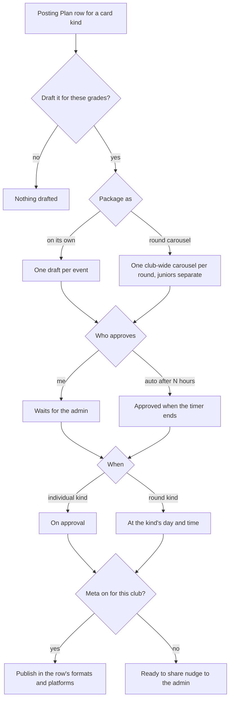
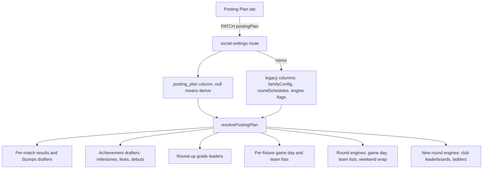

# Social Posting Plan - Plan

## Goal Capsule

- **Objective:** Give each club's volunteer admin one place to decide, per card kind, whether it drafts, how it is packaged, when it goes out, who approves it and which formats it produces. This implementation plan delivers release 1 (drafting and packaging: R1–R14, R20); release 2 (R15–R19) is a follow-up plan.
- **Product authority:** Ash (owner, Halls Head media officer). Product decisions were made with him on 2026-10-07; the Product Contract below governs scope. Where it and the Planning Contract disagree, the Product Contract wins and the conflict is surfaced, not resolved silently.
- **Open blockers:** None.
- **Stop conditions:** Stop and ask if carry-over cannot be made exactly equivalent for any existing settings combination (R14), if a club's drafts would change without the admin touching the plan, or if ladder data turns out unavailable for Halls Head's PlayHQ grades.
- **Execution profile:** Monorepo change across `lib/scorecard`, `lib/db`, `lib/api-spec`, `artifacts/api-server` and `artifacts/cricket-club`. OpenAPI-first; one generated migration (0042) applied to production by hand before republishing.
- **Tail ownership:** The implementer opens the PR and hands Ash the migration SQL for the Production SQL runner; Ash applies it and republishes.

---

## Product Contract

### Summary

A single Posting Plan page replaces Social Studio's scattered automation settings with one row per card kind. New clubs start from a named posting style and adjust only what differs. Release 1 delivers drafting and packaging: results, team lists, ladders and leaderboards as club-wide round carousels, with milestones and A Grade debuts posted individually. Release 2 adds per-kind timing, approval and export formats.

### Problem Frame

The owner's goal for a normal weekend is simple: routine round content (results, team lists, ladders, leaderboards) as one carousel per kind for the whole club, and personal moments (milestones, A Grade debuts) as their own posts. The current settings cannot express it.

Ladder and club-leaderboard cards exist in every design pack but are never drafted automatically. Grade-leader cards are drafted by the round-up engine, but only one per grade. None of the three can be set as a round carousel. The settings that do exist are spread across ten cards on the Cards tab plus a separate auto-draft panel on the Studio tab, with overlapping vocabulary ("engines" and "families" both include Round-up) and dependencies explained only in helper text ("Switch on Round-up in Automation above first"). Timing is set per round mode only, the review window is one club-wide value, and the match-day lead time is fixed in code.

This is the core of three of the owner's five complaints about Social Studio: too many options, no control over packaging, and no control over automation scheduling. The people who will use it are club volunteers who change over, so the settings must explain themselves.

### Key Decisions

- **One carousel per kind per round, not one combined round post.** Results, team lists, ladders and leaderboards each get their own club-wide carousel, so each can go out at its own time.
- **Round carousels post at a day and time the admin sets per kind; individual cards post as soon as they are approved.** Individual moments are timely; round content is predictable.
- **Approval is chosen per kind.** Each row is either "I approve" or "auto-approve after N hours".
- **Before Meta publishing is on, the planned time sends a "ready, tap to share" nudge.** The plan delivers value now instead of waiting for App Review.
- **Posting styles are the entry point to the table.** A volunteer picks a style that fills every row, then changes only what differs. This keeps the table's control while making a first setup one click.
- **Junior grades are chosen in the same grade picker, but junior cards always form their own carousels and never auto-publish.** Juniors isolation holds without a separate juniors page.
- **Score corrections on approved cards are not handled here.** The owner judged corrections rare enough at current clubs. See Dependencies / Assumptions for the accepted risk.
- **Two releases.** Release 1 is drafting and packaging; release 2 is timing, approval and formats. Today's timing, review-window and size controls keep working until release 2 replaces them.

### Actors

- A1. Club volunteer admin: sets and adjusts the Posting Plan, approves cards, shares by hand until Meta is on.
- A2. Ovation operator (Ash): picks the starting posting style when onboarding a club.
- A3. Automated drafting (the scheduled sweep after each PlayHQ ingest): drafts and packages cards according to the plan.
- A4. Destination: Meta publishing when enabled for the club, otherwise the admin sharing by hand.

### Key Flows

- F1. Weekend with the owner's setup
  - **Trigger:** Saturday's matches finish and are ingested.
  - **Actors:** A3, A1, A4
  - **Steps:** Milestone and A Grade debut drafts appear individually; after auto-approve or admin approval each goes out immediately. Results, ladder and leaderboard carousels are drafted club-wide and go out at their set times; team lists for the next round go out at their set time later in the week.
  - **Covered by:** R8–R13, R15–R19
  - **Release 1:** delivers the drafting and packaging steps only. Until release 2, approved cards go out through today's club-wide review window and Round cards time (R20), not immediately or at per-kind times.
- F2. New club setup
  - **Trigger:** A club is onboarded or a volunteer opens the Posting Plan for the first time.
  - **Actors:** A2, A1
  - **Steps:** Pick a posting style; every row fills; the volunteer adjusts any row; the plan shows it is now custom.
  - **Covered by:** R5–R7

### Requirements

**Plan surface**

- R1. One Posting Plan page lists every automatically drafted card kind as a row.
- R2. The page replaces the Automation, Round cards, Auto-post and Engines/sizes settings and the Studio tab's match-summary auto-draft; each setting appears in exactly one place.
- R3. Rows use plain words and have no hidden dependencies on other rows or cards.
- R4. The plan is usable on a phone.

**Posting styles**

- R5. A small set of named posting styles is offered, including one matching the owner's setup ("Round carousels + individual highlights").
- R6. Choosing a style fills every row; changing any row afterwards marks the plan as custom without losing the change.
- R7. A newly onboarded club starts from a chosen style rather than blank settings.

**Drafting and packaging (release 1)**

- R8. Each row sets whether that kind drafts and for which grades.
- R9. Each round-capable row sets whether it packages as individual posts, one round carousel, or both.
- R10. A round carousel covers all selected grades for the club, one per kind per round.
- R11. Ladders, grade leaderboards and club leaderboards can be packaged as club-wide round carousels; ladders and club leaderboards gain automatic drafting to make this possible.
- R12. Milestones and debuts draft individually; the grade picker can limit debut cards to A Grade (today they draft for every grade the achievements setting allows).
- R13. Junior cards always form their own carousels, separate from senior cards, and never auto-publish.
- R14. Each existing club's current behaviour carries over unchanged when the Posting Plan replaces the old settings.

**Timing, approval and formats (release 2)**

- R15. Each round-carousel row sets a posting day and time in club time.
- R16. Individual-post rows post as soon as the card is approved.
- R17. Each row sets approval to "I approve" or "auto-approve after N hours".
- R18. Each row sets its image sizes, feed post or Story, still or video, and platforms.
- R19. When Meta publishing is off for a club, the planned or approval time sends the admin a ready-to-share nudge with the row's sizes and caption prepared; when it is on, the card publishes.
- R20. Until release 2 ships, the existing round-schedule times, club-wide review window and club-wide sizes keep working.

### Acceptance Examples

- AE1. **Covers R5, R9–R12.** Given a club on the "Round carousels + individual highlights" style, when a round is ingested, then results, ladders and leaderboards each produce one club-wide carousel, and each milestone and each A Grade debut produces its own draft.
- AE2. **Covers R10, R13.** Given team lists are set to a round carousel for all grades including Under 16s, when the round's team lists are published, then senior grades form one carousel and the Under 16s team lists form a separate junior carousel that never auto-publishes. (Results carousels are senior-only: central data holds no junior results.)
- AE3. **Covers R16, R17, R19.** Given milestones are set to auto-approve after 2 hours and Meta publishing is off, when a milestone draft is created, then 2 hours later the admin receives a ready-to-share nudge for it.
- AE4. **Covers R15, R19.** Given team lists post Friday 12:00pm as an Instagram Story and Meta publishing is on, when Friday 12:00pm arrives with the carousel approved, then it publishes as a Story to Instagram.
- AE5. **Covers R14.** Given a club currently drafting results per match with no round carousel, when the Posting Plan replaces the old settings, then that club's results row reads "individual posts" and nothing it drafts changes.
- AE6. **Covers R6.** Given a club on a named style, when the admin changes the ladders row's post time, then the plan shows as custom and the change is kept.

### Scope Boundaries

**Deferred for later**

- Combining, splitting or reordering drafts in the queue after drafting (ideation idea 2).
- A drag-and-drop posting calendar with daily caps and spacing (idea 3).
- Per-kind custom templates and the Design column's editing (idea 4); the row may link to the current pack choice only.
- Handling score corrections on approved cards (idea 6).
- A combined multi-kind round post; per-club time zones; teaching the plan from queue actions.

**Outside this work**

- Changing what counts as a milestone or debut.
- Association-level or cross-club posts.

### Dependencies / Assumptions

- Meta publishing is built but switched off pending App Review; R19's publish branch only applies once it is enabled for a club.
- Club time is Australia/Perth for all current tenants; tenants carry no time zone yet.
- Image sizes are club-wide today; R18 makes them per kind.
- Ladder and leaderboard data is available from the central stats for every round the sweep processes (assumption; confirm in planning).
- Accepted risk: with per-kind auto-approve and no correction handling, a card whose numbers change after approval can be published unseen once Meta auto-publish is on.

### Outstanding Questions

**Deferred to the release 2 plan**

- Which channel carries the ready-to-share nudge (today's draft notices are in-app plus email; SMS exists only for availability) and how many nudges a busy weekend sends.

The other planning questions (when ladder and leaderboard carousels draft, which leaderboards, the starter styles, conflicting-settings carry-over) are answered in the Planning Contract's Key Technical Decisions.

### Sources / Research

- docs/ideation/2026-10-07-social-studio-review-ideation.html: owner complaints and the code evidence behind them.
- docs/plans/2026-10-01-001-feat-balanced-card-sets-plan.md: round sets, cover-plus-detail carousels, and ladder sets previously left out of scope.
- docs/plans/2026-10-06-001-feat-meta-scheduled-publishing-plan.md: Meta publishing, schedule panel and deferred weekly slots.
- docs/plans/2026-09-24-001-feat-social-studio-automation-plan.md: auto-draft, auto-post window and families.
- Current settings surfaces: `artifacts/cricket-club/src/pages/admin-social.tsx`, `artifacts/cricket-club/src/components/social-queue/automation-card.tsx`, `round-schedules-card.tsx`, `auto-post-card.tsx`, `artifacts/cricket-club/src/components/admin-social/settings-card.tsx`, `artifacts/cricket-club/src/components/social-studio/match-summary-settings.tsx`.
- Drafting and packaging: `artifacts/api-server/src/lib/draft-sweep.ts`, `artifacts/api-server/src/lib/round-schedules.ts`, `artifacts/api-server/src/lib/engines/round-sets.ts`, `artifacts/api-server/src/lib/social-families.ts`, `lib/scorecard/src/card-sets.ts`.

Product Contract preservation: changed — Outstanding Questions (planning-owned questions answered in the Planning Contract; nudge channel moved to the release 2 plan); AE2 restated on team lists because central data holds no junior results (doc review, confirmed with Ash 2026-10-15); F1 gains a release 1 note.

---

## Planning Contract

### Summary

Release 1 adds a Posting Plan, stored alongside today's settings and derived from them until a club saves one, so no club's drafts change on deploy. Every drafting gate reads one resolver. Two new club-wide round carousels (club leaderboards and ladders) are added beside the existing results, game-day and team-list carousels. A new Posting Plan tab replaces the Automation card, the Round cards mode selects, the content-engine switches and the Studio tab's match-summary auto-draft controls.

### Rows in release 1

| Row                     | Card kinds drafted                                | Package options                    | Default when derived                                                                                                                                                                                      |
| ----------------------- | ------------------------------------------------- | ---------------------------------- | --------------------------------------------------------------------------------------------------------------------------------------------------------------------------------------------------------- |
| Results                 | matchSummary, Stumps Day 1, weekend-wrap carousel | individual / round carousel / both | per-match posts from `familyConfig.results` grades + `matchResultCardsOn(weekendWrap.mode)`; carousel from `familyConfig.roundup.enabled` + `roundResultsCarouselOn(weekendWrap.mode)`, all senior grades |
| Milestones              | milestone (career crossings)                      | individual                         | from `familyConfig.achievements`                                                                                                                                                                          |
| Centuries and five-fors | century, fiveFor                                  | individual                         | from `familyConfig.achievements`                                                                                                                                                                          |
| Debuts                  | debut                                             | individual                         | from `familyConfig.achievements` (every senior grade)                                                                                                                                                     |
| Grade leaders           | gradeLeader                                       | individual                         | from `familyConfig.roundup`                                                                                                                                                                               |
| Club leaderboards       | clubLeaderboard (new carousel)                    | round carousel                     | off                                                                                                                                                                                                       |
| Ladders                 | ladder (new carousel)                             | round carousel                     | off                                                                                                                                                                                                       |
| Game day                | matchDay, roundFixtures                           | individual / round carousel        | from `familyConfig.matchday` + `roundSchedules.gameDay.mode`                                                                                                                                              |
| Team lists              | teamList, teamListRound                           | individual / round carousel        | from `familyConfig.matchday` + `roundSchedules.teamLists.mode`                                                                                                                                            |

### Key Technical Decisions

- KTD1. **A nullable `posting_plan` jsonb column; null means derive.** Mirrors `resolveFamilyConfig` and `resolveRoundSchedules`, so existing clubs carry over with no backfill and no production `UPDATE`. A saved plan stores resolved rows plus the source style id.
- KTD2. **One module, `lib/posting-plan.ts`, is the only reader of drafting settings.** Every gate in the Seams list asks its drafting gates whether a row allows a grade and how the row is packaged. Until a club saves a plan the gates evaluate the legacy settings exactly as the engines did; a saved plan is read row by row. The derived plan is what the page shows, so carry-over is exact even for legacy combinations the derived plan can only approximate. A test fails if a drafting module reads `engine*`, `familyConfig`, `matchSummaryGradeConfig` or `roundSchedules.*.mode` directly.
- KTD3. **Saving a plan also writes the legacy columns** (`familyConfig` via `syncFamilySettings`, `roundSchedules` modes with existing day and hour kept). Rows sharing one legacy family collapse with a fixed rule: the family is on if any of its rows is on, and a grade is allowed if any of its rows allows it (Game day + Team lists → matchday; Milestones + Centuries and five-fors + Debuts → achievements; Results carousel + Grade leaders → roundup). Rollback by redeploying the previous build therefore keeps drafting on with the widest earlier setting, not the exact saved plan. The auto-post and sizes cards, which remain until release 2, keep their inputs.
- KTD4. **Grade selection keeps `familyAllows` semantics** — explicit grade entries, otherwise seniors on and juniors off — plus an `others` switch (seniors or off) so "A Grade only" means unlisted grades stay off. Derived rows reproduce today's per-family grade overrides exactly.
- KTD5. **Carry-over follows today's effective behaviour, not the raw stored flags.** The derived row is whatever `familyAllows` and the round-schedule mode produce now; `syncFamilySettings` already makes `familyConfig` authoritative over `engineMatchSummary` and `matchSummaryGradeConfig`. The Results row's carousel branch follows today's weekend-wrap gate (the round-up switch, all senior grades, no results grade filter), separately from its per-match branch. Equivalence is proven by running a frozen copy of today's gates against the new gates over a settings matrix, both before a plan is saved and after saving the derived plan unchanged (U3). The one accepted difference after saving: with results carousel-only, "Stumps, Day 1" and the junior manual sweep follow individual posting rather than the bare results switch.
- KTD6. **"Leaderboards" means the club leaderboard carousel.** One slide per category (Runs, Wickets, Catches, Dismissals), each listing every senior grade's leader from `centralClubTotalsBySeason`. Per-grade leader cards from the round-up engine stay as the Grade leaders row, individual only.
- KTD7. **Ladders come from PlayHQ published ladders** (`playhqGradeLadder`, keyed by the club's PlayHQ org and grade ids). One slide per grade, or per ladder table when a grade publishes several (One Day, Two Day). Grades with no published ladder are skipped. A grade's ladder is used only when the club team's `played` count on it is at least the club's finished matches in that grade this season, so a scrape taken before PlayHQ recalculates never passes. PlayHQ grade ids come from the club's central matches joined on `playhq_match_id` to the PlayHQ game's `grade_id`. The sweep reads ladders without the central cache. If no grade qualifies, nothing drafts. The all-time `central.ladder` table is not used.
- KTD8. **New carousels are ordinary cards carrying their slides.** A club leaderboard or ladder draft is a normal `clubLeaderboard` / `ladder` input (its first slide) with a `carousel` list of every slide; `planCardSet` in `lib/scorecard/src/card-sets.ts` posts those slides in order. No new card kinds or pack templates, no cover (each slide carries its own title), and code unaware of carousels still shows a sensible single card.
- KTD9. **New carousels draft on the weekend-wrap cadence.** They run in the scheduled sweep's round engines for the latest round played in the six days before the weekend-wrap anchor, keyed `clubleaderboard-round:{season}:{round}` and `ladder-round:{season}:{round}`, and upsert like the existing round drafts (refresh while unposted).
- KTD10. **Packaging changes apply from the next round.** Changing a row never deletes or merges drafts already in the queue.
- KTD11. **Posting styles are static presets in code**, shared by web and API: "Round carousels + individual highlights" (results, team lists, ladders and club leaderboards as round carousels; milestones individual; debuts A Grade only; game day per fixture), "Every match on its own" (today's defaults), and "Results only". A plan is custom when any row differs from its style's rows. Applying a style over a custom plan needs confirmation.
- KTD12. **Results, Club leaderboards and Ladders round carousels are central-tenant only; Game day and Team lists round carousels stay available to every club, as today.** Non-central clubs see the three central-only options disabled with the reason. A non-central club's derived Results row reproduces its effective behaviour today (the native import path never read the round-schedule mode, so per-match results continue whatever the mode). Results carousels are senior-only because central data holds no junior grades.

### High-Level Technical Design

### Seams

The gates that move onto the resolver:

- `artifacts/api-server/src/lib/social-families.ts` — `resolveFamilyConfig`, `familyAllows`, `syncFamilySettings`.
- `artifacts/api-server/src/lib/match-summary-drafter.ts` — results gates and `shouldDraftGrade`.
- `artifacts/api-server/src/lib/draft-sweep.ts` — `sweepCentralMatches` per-match gate, `draftCentralRoundUps`, round-engine composition.
- `artifacts/api-server/src/lib/central-achievements.ts` — `buildAchievementDrafts` (debut branch) and `draftCentralAchievements`.
- `artifacts/api-server/src/lib/post-commit-social.ts` and `match-milestone-detector.ts` — native paths, kept consistent.
- `artifacts/api-server/src/lib/engines/match-day.ts`, `team-list.ts`, `round-sets.ts`.
- `artifacts/api-server/src/lib/round-schedules.ts` — `matchResultCardsOn`, `roundResultsCarouselOn`.

### Assumptions

- Halls Head reads from central in production (confirmed by Ash, 2026-10-07).
- Halls Head's PlayHQ grades publish ladders into `playhq.ladders` through the existing sync.
- `centralClubTotalsBySeason` already excludes private players and applies confirmed merges; U4 verifies rather than assumes.

### Sequencing

U1, then U2, then U3; then U4 and U5 one after the other (both register engines in `round-sets.ts` and `draft-sweep.ts`); then U6; then U7. U3 lands with no behaviour change on its own and is the point to stop if equivalence fails.

---

## Implementation Units

### U1. Posting Plan model, resolver and styles

**Goal:** A pure, shared definition of rows, package options, grade selection, posting styles, derivation from legacy settings, validation and the custom check.

**Requirements:** R1, R5, R6, R8, R9, R12, R13, R14

**Dependencies:** none

**Files:**

- `lib/scorecard/src/posting-plan.ts` (new), exported from `lib/scorecard/src/index.ts`
- `lib/scorecard/src/posting-plan.test.ts` (new)

**Approach:** Define the nine rows and, per row, the card kinds it governs and the allowed package options (table above). A derive function takes the effective family config and round-schedule modes and returns rows; a row-allows check reproduces `familyAllows` semantics plus the `others` switch (KTD4). Validation rejects package options a row does not allow and unknown rows. Styles are constants built from the same row shapes; a style-match check drives the custom badge. No DB or React imports, so both artifacts can use it.

**Patterns to follow:** `lib/scorecard/src/card-sets.ts` (shared pure planning with tests); `artifacts/api-server/src/lib/social-families.ts` for grade semantics.

**Test scenarios:**

- Derivation from null legacy settings yields today's defaults: results individual for seniors, achievements and round-up per legacy engine flags, game day and team lists per fixture, club leaderboards and ladders off.
- `weekendWrap.mode` perRound with round-up on gives results round carousel; both gives both; perFixture gives individual.
- Round-up off with `weekendWrap.mode` perRound derives no results carousel (and no per-match results), matching today.
- A results grade override excluding B Grade removes B Grade from per-match posts but not from the derived carousel.
- A `familyConfig.results.grades` override `{ "B Grade": false }` derives a results row that excludes B Grade and still includes other seniors.
- An unlisted junior grade is off; an explicitly listed junior grade is on.
- `others` off with only A Grade listed allows A Grade and denies B Grade and juniors.
- Covers AE6. A plan built from a style matches it; changing one row's packaging makes it custom.
- Validation rejects round carousel for Milestones and "both" for Team lists.
- Covers AE1. The "Round carousels + individual highlights" style sets results, team lists, ladders and club leaderboards to round carousel, milestones individual, and debuts to A Grade only.

**Verification:** library tests pass with the new suite; typecheck clean.

### U2. Storage, API contract and legacy mirror

**Goal:** Persist the plan, expose it resolved on GET, accept it on PATCH, and mirror legacy columns.

**Requirements:** R2, R6, R14

**Dependencies:** U1

**Files:**

- `lib/db/src/schema/social_cards.ts` (add nullable `postingPlan` jsonb)
- `lib/db/migrations/0042_posting_plan.sql` plus `meta/` snapshot and journal (generated)
- `lib/api-spec/openapi.yaml` (`PostingPlan`, `PostingPlanRow`, `PostingStyle`; resolved `SocialSettings.postingPlan`, `SocialSettingsUpdate.postingPlan`, styles in `SocialSettingsBundle`); regenerated `lib/api-zod` and `lib/api-client-react`
- `artifacts/api-server/src/routes/social-cards.ts` (GET and PATCH)
- `artifacts/api-server/src/lib/social-families.ts` (mirror helper)
- `artifacts/api-server/src/routes/social-settings-posting-plan.test.ts` (new)

**Approach:** GET returns the resolved plan (saved or derived) and the style list. PATCH with `postingPlan` validates, stores it whole, then writes `familyConfig` through `syncFamilySettings` and the three `roundSchedules` modes, keeping stored day and hour. Rows sharing a legacy family collapse per KTD3, and round-up stays on whenever the Results carousel or Grade leaders is on. Rows the legacy columns cannot express exactly (ladders, club leaderboards, per-row grade differences within a family) live only in `posting_plan`. Admin and `socialStudio` entitlement guards as today.

**Patterns to follow:** the `packColourModes` and `roundSchedules` merges in `routes/social-cards.ts`; migration style of `0010_auto_post_notifications.sql` (`ADD COLUMN IF NOT EXISTS`, `--> statement-breakpoint`).

**Test scenarios:**

- Covers AE5. GET for a tenant with no saved plan returns rows equal to the derivation of its legacy settings.
- PATCH a valid plan: stored; a later GET returns it; `familyConfig` and `roundSchedules` modes reflect it; stored day and hour unchanged.
- PATCH with round carousel on Milestones returns 400 with a message.
- PATCH without an admin session returns 401; without the `socialStudio` entitlement returns 403.
- Tenant A's PATCH leaves tenant B's settings untouched (extend `routes/settings-isolation.test.ts`).
- PATCH for a non-central tenant setting Results, Ladders or Club leaderboards to round carousel returns 400 explaining central-only (KTD12); Team lists round carousel is accepted.
- A plan whose Game day and Team lists grades differ mirrors `familyConfig.matchday` as the union; Centuries off with Milestones on keeps `familyConfig.achievements` on.

**Verification:** codegen and migration drift steps clean; the migration runs twice without error.

### U3. Drafting gates read the resolver

**Goal:** Every drafting decision goes through `resolvePostingPlan`, with identical output for every existing settings combination.

**Requirements:** R8, R9, R10, R12, R13, R14

**Dependencies:** U2

**Files:**

- `artifacts/api-server/src/lib/match-summary-drafter.ts`, `draft-sweep.ts`, `central-achievements.ts`, `post-commit-social.ts`, `match-milestone-detector.ts`, `roundup.ts`
- `artifacts/api-server/src/lib/engines/match-day.ts`, `team-list.ts`, `round-sets.ts`
- `artifacts/api-server/src/lib/round-schedules.ts`
- `artifacts/api-server/src/lib/posting-plan-equivalence.test.ts` (new)
- `artifacts/api-server/src/lib/posting-plan-readers.test.ts` (new, source-scan guard)
- extend `artifacts/api-server/src/lib/engines/round-sets.test.ts` and `draft-sweep-achievements.test.ts`

**Approach:** Replace each gate with the row it belongs to (Rows table). Both debut paths (central `buildAchievementDrafts` and the native detector) read the Debuts row, so an A Grade-only selection applies everywhere. The results carousel and per-match checks take the Results row's packaging. Keep `familyAllows` as a thin wrapper while call sites move.

**Execution note:** Write the equivalence matrix test first, with a frozen copy of today's gate logic as the oracle (not the code being rewritten), and keep it green while moving each call site.

**Test scenarios:**

- Equivalence matrix: for each combination of `familyConfig` (null, explicit, per-grade overrides), `engineMatchSummary`, `matchSummaryGradeConfig` and each `roundSchedules` mode, old and new gates agree for every card kind, grade and junior flag.
- Covers AE1. Debuts row A Grade only: a B Grade debut in central data drafts nothing; an A Grade debut drafts as today.
- Covers AE2. Team lists round carousel with Under 16s selected: the junior team lists form their own carousel draft with the junior flag, never the senior one.
- A non-central club with stored results mode per-round keeps its per-match results, as its import path always did (KTD12).
- Results individual: no results carousel drafts; results round carousel: no per-match result drafts on the central path.
- Running the scheduled sweep twice produces no duplicate drafts.
- Switching Team lists from individual to round carousel leaves existing per-fixture drafts unchanged (KTD10).
- Reader guard: no module under `artifacts/api-server/src/lib` except the resolver reads the legacy engine flags, `matchSummaryGradeConfig` or round-schedule modes.

**Verification:** API integration tests pass in CI; the equivalence matrix is green before and after the change.

### U4. Club leaderboards round carousel

**Goal:** Draft one club-wide leaderboard carousel per round when the row is on.

**Requirements:** R10, R11

**Dependencies:** U3

**Files:**

- `lib/scorecard/src/card-sets.ts` (`carousel` inputs, KTD8) and `lib/scorecard/src/round-carousels.test.ts`
- `lib/scorecard/src/club-leaderboard-input.ts` (new; shared builder moved from `clubSeasonTotalsToState` in `artifacts/cricket-club/src/components/card-forms/prefill.ts`)
- `artifacts/api-server/src/lib/engines/round-sets.ts` (new engine) and `artifacts/api-server/src/lib/draft-sweep.ts` (register it)
- `artifacts/api-server/src/lib/engines/club-leaderboard-round.test.ts` (new)

**Approach:** On the weekend-wrap cadence (KTD9), load `centralClubTotalsBySeason` for the season (passing the tenant's merges, as the weekend wrap does) and build one `clubLeaderboard` slide per category that has at least one leader, in Runs, Wickets, Catches, Dismissals order. The web prefill imports the shared builder. Seniors only.

**Patterns to follow:** `generateWeekendWrapDrafts` in `engines/round-sets.ts`; the weekend-wrap `results[]` branch in `card-sets.ts`.

**Test scenarios:**

- Row on, round played this week: one draft keyed `clubleaderboard-round:{season}:{round}` with Runs, Wickets, Catches and Dismissals slides.
- Early season with no Catches leaders: that slide is omitted; no categories at all: no draft.
- Sweep run twice: one draft, refreshed not duplicated.
- Row off: nothing drafted.
- Leaders exclude private players and apply the tenant's confirmed merges (`loadClubIdentity`), as `centralClubTotalsBySeason` does; central GUID players have no fill-in sentinel.
- `planCardSet` yields a cover plus one slide per category in every format.

**Verification:** one pack's render-harness PNG of the carousel looks right (per the pack-renderer learning, check a real PNG).

### U5. Ladders round carousel

**Goal:** Draft one club-wide ladder carousel per round from PlayHQ published ladders.

**Requirements:** R10, R11

**Dependencies:** U3

**Files:**

- `lib/scorecard/src/card-sets.ts` (`carousel` inputs, KTD8)
- `lib/scorecard/src/ladder-input.ts` (new; shared builder from `ladderRowsToState`, extended for PlayHQ rows and a ladder-table label)
- `lib/db/src/central/playhq-fixtures.ts` (new helper: club's PlayHQ grade ids for a round via `playhq_match_id`; an uncached ladder read for the sweep)
- `artifacts/api-server/src/lib/engines/round-sets.ts` and `artifacts/api-server/src/lib/draft-sweep.ts`
- `artifacts/api-server/src/lib/engines/ladder-round.test.ts` (new)

**Approach:** Resolve the club's PlayHQ org (`getTenantPlayhqOrgId`) and the PlayHQ grade ids of its senior grades in the round (central matches joined on `playhq_match_id` to the PlayHQ game's `grade_id`, via one new helper in `playhq-fixtures.ts`). Load each ladder uncached, keep grades where the club team's `played` count has caught up with its finished matches this season (KTD7), and build one `ladder` slide per ladder table in club grade order with the club's row flagged. Skip silently when the club has no PlayHQ org.

**Test scenarios:**

- Two grades with fresh ladders: one draft with two ladder slides in club grade order, club row flagged.
- A grade with One Day and Two Day tables: two slides labelled by table name.
- A grade whose ladder was scraped after the match but still shows the old `played` count is excluded; all stale gives no draft.
- A grade with no published ladder is skipped.
- A club without a PlayHQ org: no draft, no error.
- Juniors never appear.
- Sweep twice: one draft keyed `ladder-round:{season}:{round}`.

**Verification:** one pack's render-harness PNG of a two-grade ladder carousel looks right.

### U6. Posting Plan tab

**Goal:** One page where the admin picks a style and edits rows, replacing the scattered controls.

**Requirements:** R1, R2, R3, R4, R5, R6, R7, R20

**Dependencies:** U2 (U4 and U5 for those rows to draft anything)

**Files:**

- `artifacts/cricket-club/src/pages/admin-social-plan.tsx` (new) and `artifacts/cricket-club/src/components/posting-plan/` (new: row editor, grade picker, style picker)
- `artifacts/cricket-club/src/lib/admin-nav.ts` (new `plan` tab) and `artifacts/cricket-club/src/App.tsx` (route)
- `artifacts/cricket-club/src/pages/admin-social.tsx` (remove `AutomationCard`; keep `RoundSchedulesCard` for day and hour)
- `artifacts/cricket-club/src/components/social-queue/round-schedules-card.tsx` (drop mode selects, keep timing)
- `artifacts/cricket-club/src/components/admin-social/settings-card.tsx` (drop engine switches)
- `artifacts/cricket-club/src/components/social-studio/match-summary-settings.tsx` (drop engine and grade controls; keep the autoseed toggle)
- `artifacts/cricket-club/src/__tests__/posting-plan.test.tsx` (new); update `round-schedules-card.test.tsx` and `admin-social-studio.test.tsx`

**Approach:** Load the resolved plan from `useGetSocialSettings`, edit locally, save with `SaveBar` through `useUpdateSocialSettings` and invalidate the query. Each row reads as a sentence ("Results: draft for A–C Grade, post as one round carousel"). Round-carousel rows say they post when approved at the Round cards time until release 2. Central-only options are disabled with a reason for non-central clubs. The style picker shows the current style or "Custom"; applying a style over a custom plan asks to confirm.

- **First visit (R7, F2):** when the club has no saved plan (`posting_plan` is null), the page opens with a "Choose how your club posts" step listing the styles plus "Keep my current settings". Choosing a style fills the rows for review before saving; "Keep my current settings" saves the derived plan unchanged. Once a plan is saved the step never shows again.
- **Grade picker:** a dropdown with "All senior grades", "A Grade only" and "Choose grades…". "Choose grades…" opens tick-boxes grouped Seniors, Women and Juniors, plus "Include new senior grades automatically" (the `others` switch, KTD4). Ticking any junior grade shows "Junior cards post as their own carousel and never auto-publish."
- **Timing in release 1:** the Round cards card keeps showing the weekend-wrap day and hour whenever any of Results, Ladders or Club leaderboards is a round carousel, labelled as the shared time for those rows; round-carousel row sentences show that time and link to it.
- **States:** a skeleton while settings load; an error panel with Retry if loading fails; the Save bar disabled with a saving indicator during PATCH; a "No grades yet" message in the grade picker when the club has none.
- **Layout:** desktop shows a table. Phones show one summary card per row with its sentence and an on/off switch; tapping opens that row's controls, one row open at a time. The style picker sits at the top and the `SaveBar` is pinned to the bottom with an "Unsaved changes" marker.

**Patterns to follow:** `components/social-queue/round-schedules-card.tsx` (local draft, `SaveBar`, sentence descriptions); `components/admin-ui` primitives (`SettingsCard`, `data-table`, `edit-drawer`); `admin-nav.ts` and the `App.tsx` `<Redirect>` pattern.

**Test scenarios:**

- Renders nine rows from a mocked settings bundle, each with its sentence.
- Choosing "Round carousels + individual highlights" fills rows and the badge shows that style; editing one row flips the badge to Custom.
- Applying a style over a custom plan shows a confirm; cancel keeps the edits.
- Milestones offers no round-carousel option; Team lists offers no "both".
- Non-central club: Results, Ladders and Club leaderboards round-carousel options are disabled with the reason; Game day and Team lists round carousels stay enabled.
- Save sends the full plan in one PATCH; an API error shows its message; the Save bar is disabled while saving.
- Settings load failure shows the error panel; Retry refetches.
- Ladders on with Results individual: the Round cards card still shows the weekend-wrap day and hour.
- Covers F2. With no saved plan, the first-visit step shows; picking a style fills the rows unsaved; "Keep my current settings" saves the derived plan; after saving, the step does not show again.
- Grade picker: "A Grade only" sets A Grade with new senior grades excluded; "Choose grades…" shows grouped tick-boxes; ticking Under 16s shows the junior note.
- At phone width, rows render as summary cards; opening one closes the other; every control is reachable; the Save bar stays visible with the unsaved marker after an edit.
- The Cards tab no longer renders the Automation card; the Round cards card shows day and hour without mode selects.

**Verification:** web tests pass; manual check in the browser preview at desktop and 375px widths.

### U7. Migration hand-off and docs

**Goal:** Ship safely to production and keep repo docs current.

**Requirements:** R14

**Dependencies:** U2–U6

**Files:**

- `AGENTS.md` (Social Studio section: the Posting Plan is the drafting source of truth)
- `docs/runbooks/posting-plan-release.md` (new: apply `0042`, verify the column, then republish)

**Approach:** Give Ash the `0042` SQL for the Production SQL runner and a verification query on `information_schema.columns` for `social_settings.posting_plan`. Because the column is nullable and derived, deploying before any club saves a plan changes nothing.

**Test expectation:** none -- documentation and operational hand-off.

**Verification:** Ash confirms the column exists in production before republishing.

---

## Verification Contract

| Gate                  | Command                                                                                    | Applies to |
| --------------------- | ------------------------------------------------------------------------------------------ | ---------- |
| Typecheck             | `pnpm run typecheck`                                                                       | all units  |
| Lint                  | `pnpm run lint`                                                                            | all units  |
| Format                | `npx prettier@3.9.6 --check .` (CI pins 3.9.6)                                             | all units  |
| Library tests         | `pnpm run test:libs`                                                                       | U1, U4, U5 |
| API integration tests | `pnpm --filter @workspace/api-server test` (real Postgres; CI is authoritative on Windows) | U2–U5      |
| Web tests             | `pnpm --filter @workspace/cricket-club test`                                               | U6         |
| Codegen drift         | `pnpm --filter @workspace/api-spec run codegen` leaves no diff                             | U2         |
| Migration drift       | `pnpm --filter @workspace/db run generate` leaves no diff; migrate twice for idempotency   | U2         |
| Render check          | render-harness PNG of one club leaderboard and one ladder carousel                         | U4, U5     |

---

## Definition of Done

- All Verification Contract gates pass in CI.
- The equivalence matrix proves no existing club's drafts change until it saves a plan (R14).
- Ash's setup (AE1) is one style pick and produces the expected drafts in a sweep test.
- The Automation card, Round cards mode selects, content-engine switches and Studio match-summary engine controls are gone; each remaining setting appears once (R2).
- Migration 0042 SQL and the verification query are handed to Ash.
- No abandoned-attempt code, unused helpers or commented-out legacy readers remain in the diff.

### Deferred to Follow-Up Work

- Release 2 plan: per-kind posting times (R15), post-on-approval for individual rows (R16), per-kind approval (R17), per-kind formats (R18), ready-to-share nudges (R19), and retiring the auto-post and sizes cards.
- Removing the mirrored legacy columns once release 2 lands and rollback to pre-plan builds is no longer needed.
