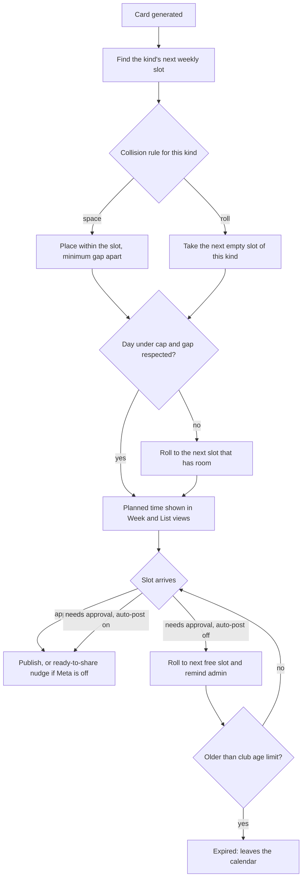
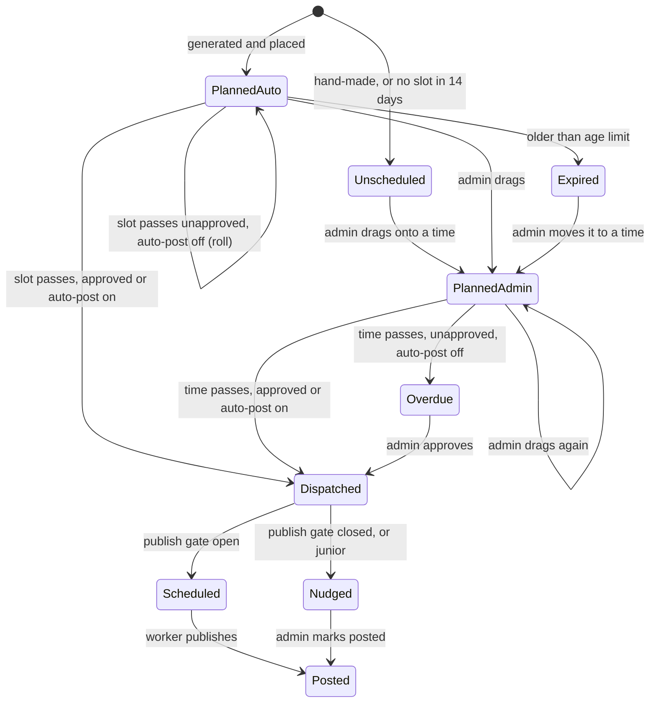
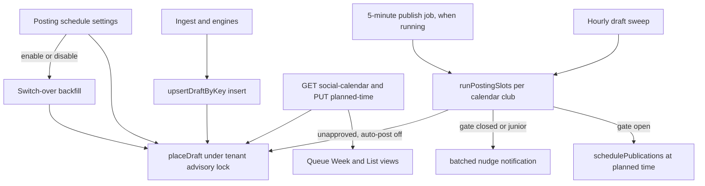

# Social Posting Calendar - Plan

## Goal Capsule

- **Objective:** Every generated social card gets a planned time automatically, and the club's volunteer admin sees and changes the whole week's posting in the queue by dragging.
- **Product authority:** Ash (owner, Halls Head media officer). Product decisions were made with him on 2026-10-07; this plan's Product Contract is the authority, then the Planning Contract, then the units.
- **Execution profile:** Deep. Schema change applied by hand in production, new settings, a slot-placement engine wired into existing sweeps, a new calendar API, and a rebuilt queue page.
- **Stop conditions:** Stop and ask Ash if a change would alter what a club currently posts without that club turning the calendar on, touch juniors isolation, or need a new cron-job.org job or secret.
- **Open blockers:** None. Meta App Review gates real publishing only; the nudge path is the live behaviour.
- **Tail ownership:** The production migration SQL is run by Ash in Replit's Production SQL runner before republishing; the plan ships the SQL and the verification query.

## As built (2026-10-15)

Where the implementation differs from the text below, this list wins:

- **Migration is `0040`, not `0035`.** `lib/db/migrations/0040_social_posting_calendar.sql` is itself idempotent and paste-ready; there is no separate `.prod.sql` file. The read-only column check lives in `docs/runbooks/meta-publishing.md` §3a.
- **`nudged_at` became `dispatched_at`**, stamped (guarded) when a due ready card is either scheduled for publishing or nudged, so a slot is handled exactly once. A further column, **`overdue_notified_at`**, makes the one-time overdue reminder for an admin-placed unapproved card idempotent.
- **Unscheduling is `POST /social-drafts/{id}/unschedule`** (with `expectedPlannedAt`), not `DELETE …/planned-time`. It pins the card as `admin` with no time, so automation never re-places it.
- **`auto_ready_at` follows `planned_at`** for calendar clubs instead of being cleared: the slot is the one deadline, and send-back, reopen and edit still clear it.
- **Rolls use no grace**, so a missed slot is never reused; first placement keeps a 60-minute grace for a slot that has just passed.
- **Switching on** places every open undispatched card (not only `planned_at IS NULL`), so re-enabling reconciles anything that changed while the calendar was off; **switching off** restores `auto_ready_at` only on automation-owned cards (`auto_ready_at` not null).
- **Settings** live in a "Posting schedule" dialog opened from the queue header (`posting-schedule-card.tsx`), shown even while the calendar is off ("Set up posting calendar").

---

## Product Contract

Product Contract preservation: changed R5 (slots are set in this plan's Posting schedule settings, not the Posting Plan, which is not built yet), R7 (the "combine" collision rule is deferred) and R13 (publishing also requires the club's existing "auto-publish" opt-in, so approving a card never silently turns on publishing); added R14–R17 from the planning-time scope confirmed with Ash on 2026-10-07. Slot timing is hourly for now, also confirmed with Ash.

### Summary

The Social Studio queue becomes the posting calendar, with a Week view (a grid on desktop) and a List view (a day-by-day agenda on phones) of the same cards. Each generated card is placed into its kind's next weekly slot within a club-wide daily cap and minimum gap, and the admin can drag any card to a new time. Slot handling rides on the existing hourly sweep, so a card goes out or nudges within about an hour of its planned time; it tightens to about 5 minutes once the Meta publish job is running.

### Problem Frame

When a round's cards are generated they land in the queue as an unordered pile. Nothing gives them a time: with Meta publishing off no draft carries a due time, and with it on, auto-publish sends every eligible card at the same moment with no cap, spacing or order. Round cards have weekly day-and-hour defaults, but individual cards have none, and the only other scheduling control is a per-draft date picker that exists only when Meta publishing is on.

The owner described the result as generation, timing and visibility being disconnected: he cannot see what goes out when, has to time cards one by one, and plans the week in his head. Weekly posting slots and batch scheduling were explicitly deferred in the Meta publishing plan. This is the "no control over automation scheduling" complaint from the Social Studio review.

### Key Decisions

- **The calendar is a view of the queue, not a new page.** Reviewing, approving, sharing and timing happen on the same card in one place, which also serves the "too many places" complaint.
- **Every kind uses weekly day-and-time slots.** Milestones and debuts have slots just like round carousels. This replaces the Posting Plan's "individual cards post as soon as approved".
- **Each kind chooses its collision rule.** When several cards of a kind share a slot, they are spaced out within it or rolled to later slots. Combining them into one carousel is deferred.
- **The daily cap and minimum gap are club-wide.** Automatic placement never breaks them; cards that would break them roll forward.
- **The admin's drag always wins.** Dropping a card past the cap or inside the gap is allowed and the day shows a warning.
- **Unapproved cards roll forward unless auto-post is on.** With auto-post off, a card still awaiting approval at its slot moves to the next free slot for its kind and the admin is reminded. With auto-post on, it is approved at its slot and goes out.
- **One club-wide age limit ends rolling.** Cards older than the limit leave the calendar and are marked expired in the queue. For clubs using the calendar it replaces the separate "only if imported within" freshness setting.
- **Hand-made cards start unscheduled.** Cards an admin makes in the editor, and cards with no slot available within 14 days, wait in an Unscheduled tray until dragged onto a time.
- **Nothing pulls forward on its own.** When a card is deleted or moved away, later cards stay where they are.
- **Dragging ships in the first release.** A read-only week view was rejected as too small to be useful.

### Actors

- A1. Club volunteer admin: reviews, approves, drags and shares cards; sets the Posting schedule.
- A2. Automated placement: gives each new card a planned time and re-places cards that roll.
- A3. Destination: Meta publishing when enabled, otherwise the admin sharing by hand after a nudge.

### Key Flows

- F1. A weekend's cards
  - **Trigger:** A round is ingested and its cards are generated.
  - **Actors:** A2, A1, A3
  - **Steps:** Each card is placed in its kind's next slot under the collision rule, cap and gap; the admin opens the queue's Week view, approves cards in place and drags a milestone from Sunday to Monday; each card publishes or nudges at its planned time.
  - **Covered by:** R1–R10, R13
- F2. Card not approved in time
  - **Trigger:** A card's slot arrives while it still needs approval and auto-post is off.
  - **Actors:** A2, A1
  - **Steps:** The card moves to its kind's next free slot and the admin is reminded; if it is still unapproved past the age limit it expires.
  - **Covered by:** R11, R12, R14

### Requirements

**Views**

- R1. The queue offers a Week view: days across, times down, cards at their planned times, each day showing posts against the cap.
- R2. The queue offers a List view of the same cards grouped by day in time order; it is the default on phones.
- R3. Both views show approved cards, cards awaiting review (marked as needing the admin), placeholders for cards the plan expects but has not generated yet, and cards already posted this week.
- R4. Approving, editing, sharing and marking posted work from a card in either view.

**Automatic placement**

- R5. Each card kind has one or more weekly day-and-time slots, set in the club's Posting schedule.
- R6. A newly generated card is given a planned time in its kind's next slot.
- R7. Each kind sets its collision rule for several cards in one slot: space within the slot, or roll to later slots.
- R8. The club sets one daily posting cap and one minimum gap between posts; automatic placement never breaks either and rolls cards forward instead.

**Moving cards**

- R9. The admin can drag any card to another day and time in the Week view, and move it in the List view.
- R10. A move that breaks the cap or gap is allowed, and the affected day shows a warning.
- R11. With auto-post off, a card still awaiting approval when its planned time arrives rolls to its kind's next free slot, and the admin is reminded.
- R12. Cards older than the club's age limit leave the calendar and are marked expired in the queue.

**Going out**

- R13. At a card's planned time it publishes when the club has Meta publishing connected and automatic publishing turned on, and otherwise the admin receives a ready-to-share nudge for it.
- R14. With auto-post on, a card still awaiting approval when its planned time arrives is approved and goes out as in R13.

**Scope of placement**

- R15. Hand-made cards, and cards with no slot available within 14 days, sit in an Unscheduled tray until the admin places them.
- R16. Removing or moving a card never moves other cards earlier.
- R17. A club that has not turned on its Posting schedule keeps today's behaviour unchanged.

### Acceptance Examples

- AE1. **Covers R6, R7.** Given milestones have a Sunday 6pm slot with "space within slot" and a 45-minute gap, when three milestones are generated on Saturday, then they are planned for Sunday 6:00, 6:45 and 7:30pm.
- AE2. **Covers R7.** Given debuts use "roll to later slots" with Sunday and Wednesday 6pm slots, when two debuts are generated on Saturday, then one is planned for Sunday 6pm and the other for Wednesday 6pm.
- AE3. **Covers R8.** Given a daily cap of 4 and Sunday already holding 4 planned posts, when a fifth card's slot falls on Sunday, then it is planned for its kind's next slot on a day with room.
- AE4. **Covers R9, R10.** Given Sunday is at its cap, when the admin drags a Monday card onto Sunday, then the move is kept and Sunday shows an over-cap warning.
- AE5. **Covers R11, R12.** Given auto-post is off, a 7-day age limit and a results carousel left unapproved, when its Sunday slot passes, then it moves to the next results slot and the admin is reminded; once it is older than 7 days it is marked expired and leaves the calendar.
- AE6. **Covers R13.** Given Meta publishing is off, when an approved card's planned time arrives, then the admin receives a ready-to-share nudge for that card.
- AE7. **Covers R3.** Given team lists are planned for Friday 12pm and not yet generated, when the admin opens the Week view on Tuesday, then a team-lists placeholder appears in Friday's 12pm slot.
- AE8. **Covers R14.** Given auto-post is on and Meta publishing is on, when an unreviewed results carousel's planned time arrives, then it is approved and scheduled to publish at that time.
- AE9. **Covers R15.** Given an admin makes a card in the editor, when they open the Week view, then the card is in the Unscheduled tray until they drag it onto a time.
- AE10. **Covers R16.** Given Sunday's 6:00pm and 6:45pm milestones, when the admin dismisses the 6:00pm one, then the 6:45pm milestone stays at 6:45pm.
- AE11. **Covers R17.** Given a club has never turned on its Posting schedule, when a round is ingested, then its drafts, auto-post and auto-publish behave exactly as before this change.

### Scope Boundaries

**Deferred for later**

- The "combine into one carousel" collision rule, and combining, splitting or reordering drafts by hand (ideation idea 2).
- Approving a whole week in one action; a "tidy the week" action that pulls cards forward.
- Separate caps or gaps per platform or per kind.
- Per-club time zones.
- Folding the Posting schedule settings into the Posting Plan table (docs/plans/2026-10-07-001-feat-social-posting-plan-plan.md, not yet on this branch).

**Outside this work**

- Changing which cards are generated or how they are packaged.
- Engagement-based best-time suggestions.

### Dependencies / Assumptions

- Club time is Australia/Perth for all current tenants; tenants carry no time zone yet.
- Meta publishing is built but switched off pending App Review; R13's publish branch applies only once it is enabled for a club.
- Instagram allows roughly 100 API-published posts per account per 24 hours; the cap setting tops out far below this.
- The Social Posting Plan will later own these settings and its "post as soon as approved" rule must be updated to weekly slots; that plan's document lives in another worktree and is not changed by this work.

### Sources / Research

- docs/ideation/2026-10-07-social-studio-review-ideation.html: owner complaints and the original calendar idea (idea 3).
- docs/plans/2026-10-06-001-feat-meta-scheduled-publishing-plan.md: publication rows, worker, deferred weekly slots and batch scheduling.
- docs/runbooks/meta-publishing.md: hand-applied production SQL, the 5-minute publish job, secrets.
- Buffer's queue-slot model: recurring weekly slots, next-available-slot placement, custom-scheduled posts locked out of automatic re-ordering (support.buffer.com, "Setting up your timezones and posting schedules"; "Re-ordering posts in your queue").

---

## Planning Contract

### Key Technical Decisions

- KTD1. **The planned time lives on the draft, not on publication rows.** `social_drafts` gains nullable `planned_at` (timestamptz), `planned_by` (`auto` or `admin`), `roll_count`, `dispatched_at` and `expired_at`. Publication rows exist only when Meta is on, so they cannot carry the plan; when a card goes out through Meta, its rows are created with `scheduled_for = planned_at`.
- KTD2. **Expiry is an additive column, not a new draft status.** `expired_at` keeps the `social_drafts_status_check` constraint unchanged, avoiding a CHECK rewrite in a hand-applied production migration. The API reports an `expired` effective status when `expired_at` is set, the same lazy-on-read pattern as `auto_ready_at` in `artifacts/api-server/src/lib/effective-draft-state.ts`. Every status-only "still to act on" filter gains `expired_at IS NULL`, including the legacy auto-post and auto-publish paths, so expired cards can never be revived by turning the calendar off.
- KTD3. **The calendar is opt-in per club, with a defined switch-over.** A `posting_schedule` jsonb on `social_settings` with an `enabled` flag; null or disabled runs today's code paths unchanged (R17). Enabling runs an idempotent backfill in one locked transaction: open generated drafts with `planned_at IS NULL` and within the age limit are placed oldest first; drafts that already have scheduled publication rows take that time as an `admin` pin; `auto_ready_at` is cleared. Disabling recomputes `auto_ready_at` from each open draft's import time, leaves `planned_at` in place but ignored, and keeps already-scheduled publication rows, so re-enabling resumes cleanly.
- KTD4. **Settings follow the round-schedules pattern.** One jsonb column holds per-kind slots and collision rules plus cap, gap and age limit, with `resolvePostingSchedule`, `mergePostingSchedule` and `invalidPostingSchedule` in a new module mirroring `artifacts/api-server/src/lib/round-schedules.ts`. Defaults seed from the club's existing round schedules so turning the calendar on keeps current round-card times.
- KTD5. **Slot kinds map from the draft's family and card kind.** A small fixed table maps `cardInput.kind` to a slot kind (results, round results, team lists, game day, milestones, debuts, achievements, round-up, other). Unmapped kinds fall back to their family's row.
- KTD6. **Placement is a pure function plus a locked writer.** `placeCard(input) → plannedAt | null` takes slots, collision rule, cap, gap, the club's already-planned times and `now`, all in Perth time, and is unit-tested without a database. Every transaction that writes `planned_at` (placement, roll, drag, backfill, slot edits) first takes a dedicated two-int tenant advisory lock (like `DEBUT_CAP_LOCK_KEY`, distinct from `MINT_LOCK_KEY`), then reads planned times, then writes; no rendering, enrichment or network calls run while it is held. The lock is needed on a single server because the hourly sweep and the 5-minute publish job overlap. The horizon is 14 days; beyond it the card is unscheduled (R15).
- KTD7. **Placement runs after create, and admin times are pinned.** `upsertDraftByKey` inserts as today (keeping its 23505 retry), then places the new draft in a second short transaction; a crash between the two leaves the card unscheduled, which the hourly run then places. Calendar clubs insert with `auto_ready_at = null`. The refresh branch never touches `planned_at`, so a regenerated card keeps its time. Automatic re-placement only touches `planned_by = 'auto'` rows (Buffer's "custom-scheduled posts are locked" precedent).
- KTD8. **Slot handling runs on the hourly sweep.** `runPostingSlots(tenantId, now)` runs in `runDraftSweep`'s scheduled path for calendar clubs, which is the only job guaranteed to run while Meta is off. When the Meta publish job is running, `routes/internal-publish-sweep.ts` also calls it for calendar clubs before the worker, tightening timing to about 5 minutes. No new cron-job.org job or secret (decided with Ash, 2026-10-07).
- KTD9. **One clock and one publish gate when the calendar is on.** Review-window promotion and legacy `scheduleAutoPublish` (`at: now`) are skipped for calendar clubs; the slot is the deadline (R14). A card publishes only when Meta publishing is enabled, the club's connection is `connected`, and the club's existing `autoPublishEnabled` opt-in is on, and it is neither junior nor ad-hoc (reusing `autoPublishCandidates`' predicates); otherwise it nudges. The age limit replaces `auto_publish_freshness_hours` for calendar clubs, including in `releaseHeld` on reconnect, anchored on `source_imported_at`, else `created_at`.
- KTD10. **Admin-placed cards never auto-expire or auto-roll.** A drag is a pin: the admin chose that time. If a pinned card is still unapproved at its time with auto-post off, it stays put, flagged overdue, and is included in the reminder.
- KTD11. **A draft has one time, `planned_at`.** For calendar clubs the drag API, the publication reschedule route and the drawer's schedule panel all write `planned_at` and move the draft's `scheduled`/`held` publication rows (`scheduled_for` and `next_attempt_at`) in the same transaction, after locking those rows `FOR UPDATE`; any row already `publishing` or `published` aborts the move with a reason. Drag writes carry `expectedPlannedAt`; a mismatch returns 409 and the client refetches. Removing a card's time, dismissing it, or a re-ingest withdrawal cancels its scheduled rows.
- KTD12. **Every automatic transition is a guarded update, and notifications come from what changed.** Roll, dispatch and expire update only when `planned_at`, `planned_by = 'auto'` (for roll and expire), `status`, `dispatched_at IS NULL` and `expired_at IS NULL` still match; notification lists are built from the rows returned by those updates, so overlapping runs never double-act or double-notify. `dispatched_at` marks both the nudge and the publish path, so a card is never sent twice even if a publication row is later cancelled; an existing manual publication for the draft is treated as already dispatched rather than raising a conflict. One notification row per club per run lists cards due to share and cards that rolled; rolled cards are reminded at most 3 times (`roll_count`).
- KTD13. **Existing draft actions reset timing.** Send back and reopen clear `dispatched_at`; for `auto` cards they re-place from now, for `admin` cards a past time becomes overdue. Approving an expired card is refused with "expired, move it to a time to revive"; moving it clears `expired_at` and pins it.
- KTD14. **Placeholders are computed on read, not stored.** The calendar endpoint derives expected round cards (results, team lists, game day) from upcoming fixtures and the Posting schedule, and drops any placeholder whose kind and round already have a draft. Individual kinds show empty slot outlines only.
- KTD15. **Drag reuses the Selection Hub's pointer drag; no new dependency.** Generalise `artifacts/cricket-club/src/components/selection/use-pointer-drag.ts` (6px threshold, touch grip, ghost, drop zones, edge scroll, Escape) to carry a generic payload. Keyboard and phone users move cards through a shared "Move to…" sheet, which satisfies WCAG 2.5.7 without a drag. Considered `@dnd-kit/core` 6.3.x; rejected because the in-repo hook already covers pointer, touch and cancel, and the keyboard path is the shared sheet. The grid is custom CSS rather than FullCalendar or Schedule-X (heavy styling; Schedule-X drag is a paid plugin from v4).
- KTD16. **Perth time is computed with the existing zone helpers.** Day bucketing, cap counts and slot-to-UTC conversion use `CLUB_TIME_ZONE` and the `Intl`-based helpers in `round-schedules.ts`, never UTC dates or a fixed +8 offset. Juniors are planned and nudged but never published through Meta.

### High-Level Technical Design

Card timing state on a draft for a calendar club:

Where the pieces sit:

### Assumptions

- Slot times are whole hours or quarter hours; the UI and API snap to 15 minutes.
- A card that rolls more than 3 times stops generating reminders but stays on the calendar until it expires.
- The pending-review badge counts cards awaiting review that are not expired, including overdue pinned cards.

### Sequencing

Schema first (U1), then the pure schedule and placement logic (U2), then the server wiring (U3, U4), then the API (U5), then the UI (U6, U7), then docs and the production handoff (U8). U6 and U7 can run in parallel once U5's contract is generated. The calendar stays off for every club until Halls Head has been enabled in production and its backfill checked.

---

## System-Wide Impact

- **Draft lifecycle:** send back, reopen, dismiss, mark posted, approve and re-ingest withdrawal all touch the new timing fields (KTD11, KTD13). Expiry does not stamp `milestone_events`; an expired milestone stays revivable.
- **Status filters:** every "still to act on" query gains `expired_at IS NULL`, including `/social-drafts/pending-count`, `auto-publish.ts`, `publications.ts`, `social-cards-sets.ts`, `match-summary-drafter.ts`, `central-achievements.ts`, `draft-recaption.ts` and `draft-enrich.ts`. A refresh keeps `expired_at` as it is.
- **Publishing:** calendar clubs never use `scheduleAutoPublish`; `releaseHeld` uses the age limit for them. Non-calendar clubs are untouched.
- **Notifications:** two new kinds render in the notification bell and the club email.
- **UI:** the queue gains Week and List views; the drawer's schedule panel writes the planned time for calendar clubs. The mobile app does not read social drafts and is unaffected.
- **Isolation:** every new query filters by tenant; juniors never reach Meta publication and never share a set with seniors.

---

## Risks & Dependencies

| Risk                                                                                                                                 | Mitigation                                                                                                                                                                                                                             |
| ------------------------------------------------------------------------------------------------------------------------------------ | -------------------------------------------------------------------------------------------------------------------------------------------------------------------------------------------------------------------------------------- |
| New code runs before the production SQL, so every draft read and every PlayHQ ingest fails on a missing column (the 10 Sep pattern). | Running and checking the SQL is a hard gate before republishing; the prod SQL file ends with a read-only `information_schema.columns` check for all six new columns (five on `social_drafts` plus `social_settings.posting_schedule`). |
| Overlapping hourly and 5-minute runs, or a run and a drag, act on the same card.                                                     | Tenant advisory lock for every `planned_at` write; guarded updates with notifications built from returned rows (KTD6, KTD12).                                                                                                          |
| A dragged card's publication rows drift from its planned time, or post after it is removed.                                          | Rows locked and moved in the same transaction; removal, dismissal and withdrawal cancel them (KTD11).                                                                                                                                  |
| Enabling mid-week strands existing ready cards; disabling triggers a burst or revives expired cards.                                 | Switch-over backfill and recompute (KTD3); legacy paths exclude expired cards (KTD2); the burst on disable is documented in the runbook.                                                                                               |
| Slot timing is up to an hour late while Meta is off.                                                                                 | Accepted by Ash for now; tightens automatically once the publish job runs.                                                                                                                                                             |
| Placement fails during ingest.                                                                                                       | Caught and logged; the card stays unscheduled and the next hourly run places it.                                                                                                                                                       |

---

## Operational Notes

Deploy order: merge; Ash pastes `lib/db/migrations/0040_social_posting_calendar.sql` into the Production SQL runner; Ash runs the read-only column check in the runbook; republish; smoke-test the queue and one ingest; enable the calendar for Halls Head only and check the backfill placed its open cards. Rollback: turn the calendar off for the club. The columns are additive and stay.

---

## Implementation Units

### U1. Schema and migration for planned times and the Posting schedule

**Goal:** Add the draft timing columns and the club's Posting schedule setting, with an idempotent migration Ash can run by hand.

**Requirements:** R5, R8, R12, R15, R17

**Dependencies:** none

**Files:**

- `lib/db/src/schema/social_cards.ts` (modify: `social_drafts` gains `planned_at`, `planned_by`, `roll_count`, `dispatched_at`, `expired_at`; `social_settings` gains `posting_schedule` jsonb with its row type)
- `lib/db/migrations/0035_social_posting_calendar.sql` (create; number re-checked against `origin/main` before generating)
- `lib/db/migrations/meta/_journal.json` and the matching snapshot (generated)
- (as built: no separate production file — migration `0040` is paste-ready; see As built)

**Approach:**

- All columns nullable or defaulted (`roll_count` default 0) so existing rows stay valid; `ADD COLUMN IF NOT EXISTS` throughout, matching `0033_social_draft_created_by.sql`.
- Checks `planned_by IN ('auto','admin')` and `roll_count >= 0`, wrapped in `0033`'s `DO $$ … duplicate_object` guard.
- Plain `CREATE INDEX IF NOT EXISTS` (not `CONCURRENTLY`) on `(tenant_id, planned_at) WHERE planned_at IS NOT NULL`.
- No change to `social_drafts_status_check` (KTD2).
- Generate with drizzle-kit through a throwaway config with relative paths on Windows, and keep the journal and snapshot chained so CI's migration-drift check passes.

**Patterns to follow:** `lib/db/migrations/0023_*.sql` (jsonb settings column), `0033_social_draft_created_by.sql` (idempotent DDL), the `RoundSchedulesRow` type in `social_cards.ts`.

**Test scenarios:**

- Applying the migration twice succeeds both times (CI re-runs `migrate`).
- An existing `social_settings` row reads `posting_schedule` as null after migration.
- An existing draft reads `planned_at` null and `roll_count` 0; inserting `planned_by = 'other'` is rejected.

**Verification:** `migrate` runs clean twice; drizzle `generate` produces no further changes; the production SQL file runs twice on a copy of the schema without error and its check query lists all six new columns (five on `social_drafts` plus `social_settings.posting_schedule`).

### U2. Posting schedule module and placement engine

**Goal:** A pure, Perth-aware module that resolves the Posting schedule and computes a card's planned time.

**Requirements:** R5, R6, R7, R8, R15, R16

**Dependencies:** U1

**Files:**

- `artifacts/api-server/src/lib/posting-schedule.ts` (create: types, defaults, `resolvePostingSchedule`, `mergePostingSchedule`, `invalidPostingSchedule`, slot-kind mapping)
- `artifacts/api-server/src/lib/posting-placement.ts` (create: `placeCard`, `nextSlotsFrom`, `dayCount`, `gapOk`)
- `artifacts/api-server/src/lib/round-schedules.ts` (modify: export the zone helpers needed for weekday/time-to-UTC and Perth day keys)
- `artifacts/api-server/src/lib/posting-schedule.test.ts` (create)
- `artifacts/api-server/src/lib/posting-placement.test.ts` (create)

**Approach:**

- Schedule shape: `enabled`, `dailyCap` (1–20), `minGapMinutes` (0–240, 15-minute steps), `ageLimitDays` (1–30), and per slot kind a list of `{day, time}` slots plus `collision: "space" | "roll"`.
- Defaults: calendar disabled; when first enabled, round-kind slots copy the club's resolved round schedules, individual kinds get one Sunday 6pm slot, cap 4, gap 45, age limit 7.
- `placeCard` walks candidate slots for the kind from `now` up to 14 days ahead. Under "space", it tries the slot time then slot time plus gap steps until the next slot of that kind or Perth midnight; under "roll", one card per slot. Each candidate must satisfy the cap for its Perth day and the gap against every planned time. It returns null past the horizon.
- Cap counts every planned card on that Perth day that is not dismissed or expired, including admin-placed and junior cards; a carousel counts as one.

**Execution note:** Implement placement test-first; it is pure logic with many boundaries.

**Patterns to follow:** `artifacts/api-server/src/lib/round-schedules.ts` and `round-schedules.test.ts`; `artifacts/api-server/src/lib/availability-schedule.test.ts` for pure-function tests.

**Test scenarios:**

- Covers AE1. Three milestones, Sunday 6pm slot, "space", 45-minute gap → 6:00, 6:45, 7:30pm Perth.
- Covers AE2. Two debuts, Sunday and Wednesday 6pm slots, "roll" → Sunday 6pm and Wednesday 6pm.
- Covers AE3. Cap 4 with four cards already on Sunday → fifth card goes to its kind's next slot on a day under the cap.
- Gap is respected against cards of other kinds already planned.
- "Space" never crosses Perth midnight: an 11:30pm slot with a 45-minute gap rolls the second card to the next slot.
- A slot at 00:30 Perth maps to the previous UTC date and counts toward the Perth day.
- Candidate slots in the past relative to `now` are skipped.
- No slots for the kind, or nothing free within 14 days → null.
- `invalidPostingSchedule` rejects caps, gaps or age limits out of range, malformed times, and a gap not on a 15-minute step.
- `resolvePostingSchedule(null)` returns the disabled default; merging a partial update keeps other kinds' slots.

**Verification:** Both test files pass; placement has no database or clock dependencies beyond its inputs.

### U3. Place cards when drafts are created

**Goal:** Every generated draft for a calendar club gets a planned time after creation, safely under concurrency.

**Requirements:** R6, R8, R15, R17

**Dependencies:** U2

**Files:**

- `artifacts/api-server/src/lib/posting-writer.ts` (create: `withPlacementLock`, `placeDraft(tenantId, draftId, now)` writing `planned_at` and `planned_by = 'auto'`)
- `artifacts/api-server/src/lib/draft-upsert.ts` (modify: insert with `auto_ready_at = null` for calendar clubs, then call `placeDraft`; never touch `planned_at` in the refresh branch; `withdrawDraft` cancels scheduled publication rows)
- `artifacts/api-server/src/routes/social-drafts.ts` (modify: ad-hoc drafts stay unplaced)
- `artifacts/api-server/src/lib/posting-writer.test.ts` (create)
- `artifacts/api-server/src/lib/draft-upsert.test.ts` (modify)

**Approach:**

- Read the club's resolved Posting schedule once per call; when disabled, behave exactly as today (R17).
- Placement failure never fails ingest: catch, log, and leave the draft unscheduled for the hourly run to place.

**Patterns to follow:** the existing `autoReadyAtFor` computation beside the insert in `draft-upsert.ts`; the 23505 retry pattern there; `DEBUT_CAP_LOCK_KEY` for the lock key.

**Test scenarios:**

- Calendar club: an inserted milestone draft gets `planned_at` in the next Sunday 6pm slot, `planned_by = 'auto'` and `auto_ready_at` null.
- Covers AE11. Non-calendar club: an inserted draft has `planned_at` null and `auto_ready_at` set as before.
- Refreshing an existing draft with changed data keeps its `planned_at`, including an admin-placed time.
- Covers AE9. An ad-hoc draft created through the editor route has `planned_at` null.
- Two drafts inserted concurrently for the same slot under "roll" end up in different slots.
- A tenant-B draft never counts toward tenant A's cap.
- Placement throwing after the insert leaves the draft created and unscheduled.
- A re-ingest withdrawal of a planned draft with scheduled publication rows cancels those rows.

**Verification:** Tests pass against the CI-seeded database; existing `draft-upsert.test.ts` cases still pass unchanged.

### U4. Slot arrival: dispatch, roll and expire

**Goal:** When a planned time arrives, the card is dispatched, rolls, or expires, idempotently, on the existing sweeps.

**Requirements:** R11, R12, R13, R14, R16, R17

**Dependencies:** U3

**Files:**

- `artifacts/api-server/src/lib/posting-slots.ts` (create: `runPostingSlots(tenantId, now)`)
- `artifacts/api-server/src/lib/draft-sweep.ts` (modify: call it in the scheduled path for calendar clubs, also placing any still-unscheduled generated drafts; skip review-window promotion and `scheduleAutoPublish` for calendar clubs)
- `artifacts/api-server/src/routes/internal-publish-sweep.ts` (modify: when the job runs, call `runPostingSlots` for calendar clubs before the worker)
- `artifacts/api-server/src/lib/publishing/auto-publish.ts` (modify: exclude calendar clubs and expired drafts; export the junior and ad-hoc predicates for reuse)
- `artifacts/api-server/src/lib/publishing/publications.ts` (modify: expired filter)
- `artifacts/api-server/src/lib/publishing/connections.ts` (modify: `releaseHeld` uses the age limit for calendar clubs)
- `artifacts/api-server/src/lib/effective-draft-state.ts` (modify: expired effective status; no review-window promotion for calendar clubs)
- `artifacts/api-server/src/lib/draft-notifications.ts` (modify: `posts_due` and `cards_rolled` kinds, batched, with email copy)
- the status filters listed under System-Wide Impact (modify: add `expired_at IS NULL`)
- `artifacts/api-server/src/lib/posting-slots.test.ts` (create)
- `artifacts/api-server/src/lib/publishing/auto-publish.test.ts`, `auto-post.test.ts`, `draft-sweep.test.ts` (modify)

**Approach:**

- Select the tenant's drafts with `planned_at <= now`, not posted or dismissed, `dispatched_at` and `expired_at` null.
- Ready, or awaiting review with auto-post on: approve if needed, set `dispatched_at`, then if the publish gate is open (KTD9) create publication rows at `planned_at`; otherwise add the card to the club's batched "ready to share" notification.
- Awaiting review with auto-post off: `auto` cards re-place from `now` and increment `roll_count`; `admin` cards stay and are flagged overdue (KTD10). Add to the "rolled" reminder while `roll_count <= 3`.
- Expire `auto` cards whose age exceeds `ageLimitDays`.
- All writes are guarded updates and notifications are built from returned rows (KTD12).

**Execution note:** Start with an integration test that drives `runPostingSlots` with an explicit `now` across a weekend.

**Patterns to follow:** `persistDueDrafts` and `scheduleAutoPublish` guarded updates; `notifyDraftsReady` batching; `auto-publish.test.ts` setup with injected destination and renderer fakes.

**Test scenarios:**

- Covers AE6. Meta off: an approved card at its planned time gets `dispatched_at` and one notification row lists it; a second run sends nothing new.
- Covers AE8. Meta on, connected, auto-publish on, auto-post on: an unreviewed results carousel is approved and gets publication rows scheduled at `planned_at`.
- Meta on but the club's auto-publish opt-in off: an approved card is nudged, not published.
- Covers AE5. Auto-post off: an unapproved `auto` card rolls to the next results slot, `roll_count` becomes 1, and a "rolled" reminder is written; after the age limit it gets `expired_at` and leaves the candidate set.
- An unapproved `admin` card with auto-post off stays at its time and appears in the reminder as overdue.
- Junior card with Meta on: nudged, never scheduled for publication.
- A dispatched card whose publication is later cancelled is not dispatched again.
- A draft that already has a manual publication row is marked dispatched without error.
- Covers AE10. Dismissing one planned card does not change any other card's `planned_at`.
- Covers AE11. Non-calendar club: auto-post promotion and `at: now` auto-publish behave exactly as before, and expired drafts are never auto-published.
- Two concurrent `runPostingSlots` calls for the same tenant produce one set of publication rows and one notification.
- The fourth roll of a card writes no reminder.
- Expired drafts are excluded from the pending-review count.

**Verification:** New and modified tests pass; the publish-sweep route test still returns `{skipped: true}` when publishing is off and secrets are unset.

### U5. Calendar, planned-time and settings API

**Goal:** Expose the week's cards, placeholders and counts, planned-time moves, timing-aware draft actions, and the Posting schedule settings with its switch-over, through the OpenAPI contract.

**Requirements:** R1, R2, R3, R5, R9, R10, R15, R17

**Dependencies:** U2, U3, U4

**Files:**

- `lib/api-spec/openapi.yaml` (modify: `GET /social-calendar`, `PUT /social-drafts/{id}/planned-time`, `DELETE /social-drafts/{id}/planned-time`, `postingSchedule` on `SocialSettings` and `SocialSettingsUpdate`, draft `plannedAt`/`plannedBy`/`expiredAt`/`overdue`)
- `lib/api-client-react/**` and `lib/api-zod/**` (generated)
- `artifacts/api-server/src/routes/social-calendar.ts` (create)
- `artifacts/api-server/src/routes/social-drafts.ts` (modify: planned-time endpoints; send back, reopen, approve and dismiss apply KTD11 and KTD13; pending-count excludes expired)
- `artifacts/api-server/src/routes/social-publications.ts` (modify: reschedule writes `planned_at` for calendar clubs)
- `artifacts/api-server/src/routes/social-cards.ts` (modify: settings GET/PATCH merge and validate `postingSchedule`; run the enable/disable switch-over)
- `artifacts/api-server/src/lib/posting-switchover.ts` (create)
- `artifacts/api-server/src/routes/social-calendar.test.ts` (create)
- `artifacts/api-server/src/routes/social-drafts-planned-time.test.ts` (create)
- `artifacts/api-server/src/lib/posting-switchover.test.ts` (create)

**Approach:**

- `GET /social-calendar?from&to` (Perth dates, max 14 days) returns cards with planned times in range, posted cards in range, the Unscheduled tray, placeholders (KTD14), per-day counts against the cap, and over-cap or inside-gap warnings.
- `PUT planned-time` takes `plannedAt` (snapped to 15 minutes) and `expectedPlannedAt`; under the tenant lock it sets `planned_by = 'admin'`, clears `dispatched_at` and `expired_at` when moved into the future, and moves publication rows (KTD11). Mismatch → 409; publishing or published → refusal with a reason; a past time → refusal.
- `DELETE planned-time` moves a card to the Unscheduled tray and cancels its scheduled rows.
- Settings PATCH runs `invalidPostingSchedule`; enabling seeds defaults from round schedules (KTD4) and runs the backfill; disabling recomputes `auto_ready_at` (KTD3). The freshness-versus-window cross-check is skipped for calendar clubs.
- All routes `requireAdmin` plus the `socialStudio` entitlement and filter by tenant.

**Patterns to follow:** `routes/social-cards.ts` settings PATCH; `routes/social-publications.ts` reschedule; regenerate with the local orval binary (`cd lib/api-spec && ./node_modules/.bin/orval --config ./orval.config.ts`) and restore `pnpm-lock.yaml` if touched.

**Test scenarios:**

- Covers AE7. A calendar club with Friday 12pm team lists and an upcoming fixture round but no team-list draft returns a team-lists placeholder at Friday 12pm; once the draft exists, the placeholder is gone.
- Covers AE4. Moving a Monday card onto a full Sunday succeeds and the response flags Sunday over cap.
- Move with a stale `expectedPlannedAt` → 409; move of a card whose publication is publishing → refused; move into the past → refused.
- Moving a card with `scheduled` publication rows updates their `scheduled_for` and `next_attempt_at`.
- `DELETE planned-time` puts the card in the tray, cancels its scheduled rows and leaves other cards unchanged.
- Send back on a dispatched `auto` card clears `dispatched_at` and re-places it; reopen on a dismissed card with a past time re-places it.
- Approving an expired card is refused; moving it to a future time revives it as an `admin` pin.
- Enabling the calendar with three ready drafts and one with a scheduled publication: all four end up planned, the scheduled one as an `admin` pin at its scheduled time, and `auto_ready_at` cleared.
- Disabling the calendar restores `auto_ready_at` on open drafts and leaves scheduled publication rows in place.
- Another tenant's draft id → 404.
- Settings PATCH with an invalid cap → 400; enabling for the first time returns slots seeded from round schedules.
- The calendar response never includes another tenant's or a dismissed card.

**Verification:** Route and switch-over tests pass; the pending-count case in `social-drafts-v2.test.ts` is updated and passes; codegen drift check is clean; generated hooks compile.

### U6. Posting schedule settings panel

**Goal:** Let the admin turn the calendar on and set slots, collision rules, cap, gap and age limit.

**Requirements:** R5, R7, R8, R12, R17

**Dependencies:** U5

**Files:**

- `artifacts/cricket-club/src/components/social-queue/posting-schedule-card.tsx` (create)
- `artifacts/cricket-club/src/pages/admin-social-queue.tsx` (modify: open the panel from the Week view)
- `artifacts/cricket-club/src/components/social-queue/auto-post-card.tsx` (modify: when the calendar is on, explain that slots replace the review window and hide the freshness field)
- `artifacts/cricket-club/src/components/social-queue/posting-schedule-card.test.tsx` (create)

**Approach:**

- One row per slot kind: slot chips (day plus time, add and remove) and a "space them out / one per slot" choice; club-wide cap, gap and age limit below.
- Turning the calendar on or off shows a one-line explanation of what happens to cards already in the queue.
- Plain words and Perth time labels; no cross-card dependencies.

**Patterns to follow:** `round-schedules-card.tsx` (day and hour pickers, Perth wording), `auto-post-card.tsx` (validation and save).

**Test scenarios:**

- Turning the calendar on shows slots prefilled from the club's round schedules.
- Adding a Wednesday 6pm debut slot and saving sends the merged schedule.
- A cap of 0 shows a validation message and blocks save.
- With the calendar on, the auto-post card no longer shows the freshness field.

**Verification:** Component tests pass with `NODE_ENV=test`; manual check in the dev preview.

### U7. Queue Week and List views with drag and Move to

**Goal:** Turn the queue into the calendar: Week grid with drag on desktop, List agenda on phones, shared Move to sheet, Unscheduled tray.

**Requirements:** R1, R2, R3, R4, R9, R10, R15

**Dependencies:** U5

**Files:**

- `artifacts/cricket-club/src/components/selection/use-pointer-drag.ts` (modify: generic payload and drop-target types, behaviour unchanged for the Selection Hub)
- `artifacts/cricket-club/src/components/social-calendar/week-grid.tsx` (create)
- `artifacts/cricket-club/src/components/social-calendar/day-list.tsx` (create)
- `artifacts/cricket-club/src/components/social-calendar/calendar-card.tsx` (create)
- `artifacts/cricket-club/src/components/social-calendar/move-to-sheet.tsx` (create)
- `artifacts/cricket-club/src/components/social-calendar/unscheduled-tray.tsx` (create)
- `artifacts/cricket-club/src/components/social-calendar/calendar-time.ts` (create: Perth day keys, snapping, cell-to-time)
- `artifacts/cricket-club/src/hooks/use-media-query.ts` (create)
- `artifacts/cricket-club/src/pages/admin-social-queue.tsx` (modify: Week / List / Table view switch; existing table and filters stay as the third view)
- `artifacts/cricket-club/src/components/social-queue/draft-drawer.tsx` and `schedule-panel.tsx` (modify: for calendar clubs the panel shows and sets the planned time instead of a separate publish time)
- the notification bell component (modify: render `posts_due` and `cards_rolled`)
- `artifacts/cricket-club/src/components/social-calendar/calendar-time.test.ts` (create)
- `artifacts/cricket-club/src/components/social-calendar/week-grid.test.tsx` (create)
- `artifacts/cricket-club/src/components/selection/use-pointer-drag.test.ts` (create or extend)

**Approach:**

- Week grid: CSS grid of seven Perth days by 15-minute rows over the club's posting hours; cards absolutely positioned; day headers show "n / cap" with an over-cap tone; placeholders and empty slots as outlined boxes.
- Drop computes the Perth time from the cell, snaps to 15 minutes, applies optimistically, sends `expectedPlannedAt`, and rolls back with the server's reason on refusal or 409 (then refetches).
- List view is the default below `md` and offers Move to (next 7 days, the kind's slot times as quick picks, custom time) instead of drag; the same sheet opens from a keyboard-focused card on desktop.
- Clicking a card opens the existing `DraftDrawer`, so approve, edit, share and mark posted are unchanged (R4).
- Cards show status tone, junior badge, "pinned" for admin times, "overdue" when flagged and "expired" in the tray.
- Day columns derive from Perth time, never the browser's zone.

**Execution note:** Keep logic in `calendar-time.ts` and the drag hook so components stay thin; test those pure helpers first.

**Patterns to follow:** `components/selection/apply-move.ts` and its test (pure logic beside UI); `draft-meta.ts` Perth formatting and status tones; `DraftDrawer` integration in `admin-social-queue.tsx`.

**Test scenarios:**

- `calendar-time`: a drop on Sunday's 6:45pm cell yields 10:45 UTC; 00:30 Perth buckets into the right day; snapping rounds 6:52pm to 6:45pm.
- Week grid renders a planned card in the right column and row, a placeholder outline, and "4 / 4" in an over-cap tone when the response flags it.
- A refused drop restores the card to its previous cell and shows the reason.
- Move to sheet: choosing a quick-pick slot calls the planned-time mutation with the expected value.
- Below the `md` breakpoint the List view is shown by default.
- Unscheduled tray lists hand-made cards; dragging one onto a cell places it.
- For a calendar club the drawer's schedule panel shows the planned time and saving it calls the planned-time mutation.
- The notification bell renders a `posts_due` notification with a link to the queue.
- Selection Hub drag still works with the generalised hook (existing behaviour test).

**Verification:** Web tests pass with `NODE_ENV=test`, including `meta-publishing-ui.test.tsx` and `notification-bell.test.tsx`; manual check in the dev preview at desktop and phone widths, including a touch drag on a tablet-sized viewport.

### U8. Docs, runbook and production handoff

**Goal:** Ship the production steps and keep project docs truthful.

**Requirements:** R17

**Dependencies:** U1–U7

**Files:**

- `docs/runbooks/meta-publishing.md` (modify: calendar clubs skip review-window promotion and `at: now` auto-publish; posting slots run hourly and on the publish job when it runs; disabling the calendar may release a burst of due cards)
- `docs/runbooks/meta-publishing.md` §3a (deploy order and read-only column check)
- `AGENTS.md` (modify: the calendar's state and the opt-in flag)
- `CONCEPTS.md` (modify: refine "Posting slot"; add "Posting schedule" and "Unscheduled tray")

**Approach:** Write the deploy order from Operational Notes into the runbook. No new env vars or cron jobs.

**Test expectation:** none -- documentation only.

**Verification:** Runbook steps match the shipped code; the SQL file matches the generated migration.

---

## Verification Contract

| Gate            | Command or check                                                                                                                                                                                                                                                                                  | Applies to |
| --------------- | ------------------------------------------------------------------------------------------------------------------------------------------------------------------------------------------------------------------------------------------------------------------------------------------------- | ---------- |
| API tests       | `pnpm --filter @workspace/api-server exec vitest run <files>` against a migrated, CI-seeded database (embedded Postgres on Windows, port 55432), including the modified `auto-publish.test.ts`, `auto-post.test.ts`, `draft-sweep.test.ts`, `draft-upsert.test.ts` and `social-drafts-v2.test.ts` | U1–U5      |
| Web tests       | `cd artifacts/cricket-club && NODE_ENV=test ./node_modules/.bin/vitest run` (full suite)                                                                                                                                                                                                          | U6, U7     |
| Typecheck       | `./node_modules/.bin/tsc --build lib/api-client-react lib/object-storage-web lib/scorecard lib/api-zod`, then the root typecheck                                                                                                                                                                  | all        |
| Codegen drift   | orval run via the local binary produces no diff after commit                                                                                                                                                                                                                                      | U5         |
| Migration drift | drizzle `generate` produces nothing new; `migrate` runs twice cleanly                                                                                                                                                                                                                             | U1         |
| Formatting      | `npx -y prettier@3.9.6 --write <touched files>`                                                                                                                                                                                                                                                   | all        |
| Behaviour       | Dev preview: enable the calendar with open drafts and see them placed, ingest or seed a round, drag a card, run the hourly sweep past a slot with Meta off and see one nudge, disable and see `auto_ready_at` restored                                                                            | U3–U7      |

---

## Definition of Done

- All units' test scenarios are implemented and pass; existing auto-post, auto-publish, draft-upsert and publish-worker tests pass, changed only where calendar behaviour is new.
- A club that never enables the Posting schedule behaves exactly as before (AE11 tests green).
- Every new query filters by tenant, and junior cards are never scheduled for Meta publication.
- Expired drafts are excluded from every "still to act on" path.
- The production SQL file and read-only check are in the runbook, and the deploy order is written down for Ash.
- CI is green: lint, typecheck, codegen drift, migration drift, API and web tests.
- No abandoned-attempt code, unused helpers or debug logging remain in the diff.
