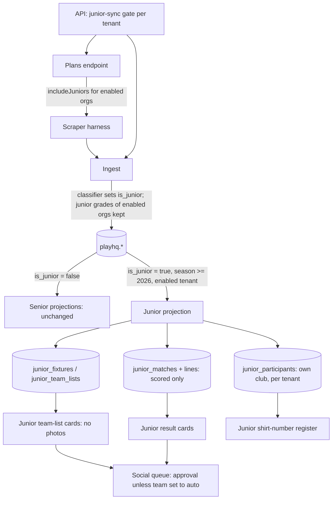
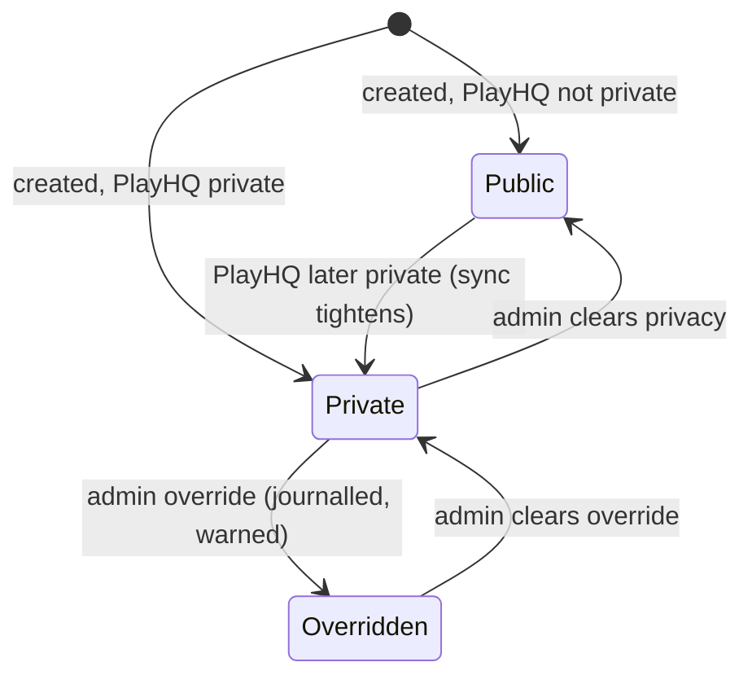

# Junior PlayHQ Sync - Plan

## Goal Capsule

- **Objective:** Let any enabled club's junior teams sync from PlayHQ like its senior teams do — fixtures, team lists with shirt-number cards, results and scorecards, and junior result cards — with junior data kept separate from senior data and from other clubs.
- **Product authority:** Ash (Ovation). Halls Head and its 14 junior teams are the first club and the acceptance case.
- **Open blockers:** None.
- **Execution profile:** Deep feature across the scraper plan, ingest, `lib/db`, the API, the web app and the social sweep. Units run in dependency order U1 → U8.
- **Stop conditions:** Stop and surface if a change would let junior rows reach senior tables or `central.*`, change behaviour for a club without junior sync, or touch junior seasons before 2026/27.

---

## Product Contract

### Summary

Juniors becomes a per-club feature of the PlayHQ sync.
For each enabled club, the sync reads that club's junior teams from its own PlayHQ organisation, from the 2026/27 season onward.
It brings in junior fixtures, selected sides as junior team lists, and results and scorecards wherever PlayHQ publishes them.
It creates junior players as they first appear, so the juniors shirt-number register can match them.
Junior team-list cards show shirt numbers, and junior result cards are drafted for review.

### Problem Frame

Halls Head wants its junior season to appear in the app the way its senior season does, and other clubs will want the same.

Today the PlayHQ sync deliberately discards junior grades at every step, from the scraper through ingest to every downstream reader.
The junior match history in the app came from a one-off bulk load and is not kept up to date.
So there are no junior fixtures, team lists or team-list cards.
Junior results exist only for seasons that were bulk-loaded.
New junior players never reach the app, which also means the juniors shirt-number register cannot match them: a club uploading this season's junior numbers sees most new players come back unmatched.

### Key Decisions

- **Separate junior pipeline.** Junior fixtures, team lists, results and players get junior-only stores, screens and routes. They never reuse senior fixture, team-list or stats storage. This keeps the juniors isolation rule (junior tables, juniors routes only, never blended) for every club.
- **Lift the "juniors excluded at ingest" rule, for enabled clubs only.** The sync captures junior grades only for clubs with juniors switched on. For all other clubs, junior grades are still dropped exactly as today.
- **Gated by plan, switched on by the platform admin.** Juniors is a plan entitlement, ready for when billing goes live. While billing is dormant, the platform admin switches juniors on per club, so no club gets it by default.
- **This season onward.** The sync owns 2026/27 and later. Seasons already loaded stay exactly as they are, which keeps the one-ingestion-method-per-grade-and-season rule.
- **Per-grade scoring.** Grades where PlayHQ publishes scorecards get results, stats and result cards. Unscored grades get fixtures, team lists and team-list cards only.
- **Club-controlled naming.** Each club chooses how junior players are named on public pages and social cards, for example full name, first name and initial, or first name only. Admins can also override PlayHQ's private flag for individual players.
- **Club-controlled publishing per junior team.** For each junior team, the club chooses whether its cards always need admin approval or follow the club's auto-post settings.

### Actors

- A1. Platform admin — switches juniors on per club while billing is dormant.
- A2. Club admin — picks the naming style, the publishing rule per junior team and privacy overrides; reviews junior cards; manages junior shirt numbers.
- A3. PlayHQ sync — captures, loads and projects an enabled club's junior grades.
- A4. Public visitor / social audience — sees junior fixtures, team lists, results and cards.

### Requirements

**Enablement**

- R1. Juniors is a plan entitlement. While billing is dormant, a club gets junior sync only when the platform admin switches it on for that club.
- R2. A club without juniors switched on sees no change: its junior grades are still dropped at ingest, and nothing junior is projected for it.
- R3. A club's juniors area appears once the club has junior data, as it does today.

**Capture and identification**

- R4. For each enabled club, the sync captures that club's junior teams from its own PlayHQ organisation, from the 2026/27 season onward.
- R5. Junior grades are recognised across associations' naming styles, for example PCA's "Year 4 Gold" and WA's own labels.
- R6. A club's grades that cannot be classified as junior or senior are reported to the platform admin and never guessed.
- R7. The sync schedule covers junior matches for enabled clubs, alongside senior matches.

**Junior data**

- R8. Upcoming junior games appear as junior fixtures in the club's juniors area and admin.
- R9. A junior team's selected side in PlayHQ becomes that fixture's junior team list. An admin-saved junior team list is never overwritten by the sync.
- R10. Finished junior matches with published scorecards flow into the club's junior match pages, stats and player profiles.
- R11. Junior players are created the first time they appear for the club, keyed on their PlayHQ identity, so later uploads and the juniors shirt-number register can match them.
- R12. Junior seasons already in the app before 2026/27 are not changed by the sync.
- R13. Junior and senior data are never blended. A player who appears in both keeps a separate junior record, linked to their senior record only through the existing senior link.
- R14. One club never sees or edits another club's junior data.

**Display and naming**

- R15. Each club chooses a naming style for junior players on public pages and social cards. Admins and admin screens always see full names.
- R16. PlayHQ's private flag withholds a junior player's name publicly by default. A club admin can override it per player, and the admin screen shows a warning while the override is set.

**Social**

- R17. Each junior team list produces a junior team-list card showing players' shirt numbers for the season, using the club's naming style.
- R18. Each finished, scored junior match can produce a junior result card. Unscored grades produce no result cards.
- R19. For each junior team, the club chooses whether its cards always need admin approval or follow the club's auto-post settings. The default is admin approval.
- R20. Junior cards come only from junior data and are labelled as junior content, separate from senior cards.

**Safeguards**

- R21. Junior cards carry no player photos. _Superseded 16 Oct 2026 by plan `2026-10-16-001-feat-junior-card-photos-plan.md` (ADR-007): a junior card may feature a junior player's own uploaded photo unless the family's consent is withheld._
- R22. Opposition juniors appear only on the scorecard of the match they played. Publicly they show by initials; they never become the club's junior players and are never named on cards.
- R23. Switching junior sync off for a club stops capture and projection, holds that club's unposted junior cards, and hides its synced junior fixtures and team lists from public pages. Synced match data is kept.
- R24. The `juniors` entitlement is not sold or enforced as a paid feature until PlayHQ licence or partner access covers junior data. Until then junior sync is enabled only by the platform admin.

### Key Flows

- F1. Club enables juniors
  - **Trigger:** Platform admin switches juniors on for a club.
  - **Actors:** A1, A3
  - **Steps:** The next sync captures that club's junior grades. Unclassified grades are left to the Competitions screen. Fixtures, team lists and any finished scored matches for 2026/27 are loaded. Junior players are created. The juniors area appears.
  - **Covered by:** R1, R3–R8, R11
- F2. Match week
  - **Trigger:** A junior team is named in PlayHQ before its game.
  - **Actors:** A3, A2
  - **Steps:** The sync copies the side into the junior team list. A junior team-list card is drafted with shirt numbers and the club's naming style. It is held for approval, or follows auto-post, according to that team's setting.
  - **Covered by:** R9, R15–R17, R19
- F3. After the game
  - **Trigger:** A scored junior match finishes and PlayHQ publishes the scorecard.
  - **Actors:** A3, A2
  - **Steps:** The match, batting, bowling and roster land in the junior match pages and stats. A junior result card is drafted and routed by the team's publishing setting.
  - **Covered by:** R10, R13, R18–R20
- F4. Shirt numbers for new juniors
  - **Trigger:** A club uploads its junior shirt-number sheet after the sync has run.
  - **Actors:** A2
  - **Steps:** Players created by the sync match by PlayHQ identity, so their numbers are assigned instead of coming back unmatched.
  - **Covered by:** R11

### Acceptance Examples

- AE1. **Covers R1, R2.** Given billing is dormant and juniors is off for a club, its junior grades are dropped at ingest and its juniors area shows no new data. After the platform admin switches juniors on, the next sync loads that club's 2026/27 junior fixtures.
- AE2. **Covers R12.** Given Halls Head's 2025/26 junior matches came from the one-off load, after juniors is enabled those 2025/26 matches are unchanged and only 2026/27 onward comes from the sync.
- AE3. **Covers R16.** Given a junior flagged private in PlayHQ and a club naming style of first name and initial, that player shows as withheld on public pages and cards. When an admin overrides the flag, the player shows as "Ollie G" and the admin screen warns that a private player is being named.
- AE4. **Covers R18.** Given a Year 4 grade with no published scores and a Year 9 grade with scorecards, the Year 9 match produces a result card and stats, while the Year 4 match produces a team-list card only.
- AE5. **Covers R19.** Given Year 10-11 is set to auto-post and Year 5 Gold to admin approval, a Year 10-11 team-list card follows the club's auto-post window, while the Year 5 Gold card waits in the queue for approval.
- AE6. **Covers R13, R14.** Given a Year 10-11 player who also plays senior grades, their junior innings never appear in senior stats and their senior innings never appear in junior stats. Another club's admin cannot see either.

### Scope Boundaries

- Re-pulling or replacing junior seasons loaded before 2026/27.
- Juniors for clubs not on PlayHQ sync.
- Turning billing or entitlement enforcement on.
- Junior statistics records, honour boards or milestones beyond what the existing juniors area already derives from junior match data.
- Commercial use of scraped junior data (see Dependencies / Assumptions).

### Dependencies / Assumptions

- The juniors shirt-number register (`docs/plans/2026-10-06-001-feat-season-shirt-numbers-plan.md`) is in place; R11 is what lets it match new players.
- Junior data from PlayHQ is scraped, so it is used for the pilot only and not commercialised, per the project's data-governance rule. This applies with extra care because the data concerns children.
- PlayHQ publishes junior fixtures and named sides for the junior grades in the same way it does for senior grades. Scorecard availability varies by grade.
- The PlayHQ Profile ID in a club's participant export is assumed, not verified, to be the same identifier the sync uses for junior players. The juniors shirt-number upload already falls back to a unique exact-name match when an id does not match.
- A club's junior teams may sit under a different PlayHQ organisation from its senior teams (a separate junior club). The design supports an optional junior organisation per club.

### Outstanding Questions

**Deferred to Implementation**

- Whether Halls Head's junior teams sit under its senior PlayHQ organisation or a separate junior one. Check in U4 before enabling; set the junior organisation if separate.
- How long an enabled club's weekly and match-day runs take with juniors included, measured in U4 against the workflow's 55-minute limit.

### Sources / Research

- `artifacts/api-server/src/lib/playhq-ingest.ts` — `dropJuniorGrades` removes junior grades on ingest.
- `.claude/skills/playcricket-stats-scraper/harness.js` — the harness defaults to `includeJuniors: false` and filters grades by its junior pattern.
- `lib/db/src/playhq-ingest/load.ts`, `project.ts`, `central-project.ts`, `cadence.ts` — each downstream step reads senior grades only.
- `lib/db/src/schema/juniors.ts` and `scripts/sql/juniors-etl.sql` — junior tables, loaded today only by the one-off load.
- `artifacts/api-server/src/routes/juniors-tenant-isolation.test.ts` — junior data is scoped by club, independent of central reads.
- `artifacts/api-server/src/routes/juniors-shirt-numbers.ts` — junior routes refuse clubs with no junior data.
- `artifacts/api-server/src/lib/entitlements.ts` — plan entitlements, dormant until billing is enabled.
- `docs/plans/2026-10-01-001-feat-playhq-scheduled-sync-plan.md` — the sync this extends; records "juniors are excluded at ingest" as the rule now being lifted for enabled clubs.

**Product Contract preservation:** changed — R21–R24 added as safeguards after document review (no photos on junior cards, opposition juniors not treated as the club's players, switch-off behaviour, no paid juniors before licensing). Each is the conservative reading of the existing decisions for children's data; they narrow behaviour and do not widen scope.

---

## Planning Contract

### Key Technical Decisions

- KTD1. **Three-part gate, decided once in the API layer.** Junior sync runs for a tenant only when PlayHQ sync is on, a new platform-admin switch `tenants.junior_sync_enabled` is on (default off), and the tenant's entitlements include `juniors`. While billing is dormant the entitlement reads as on, so the switch is the effective control (R1, R24). The helper lives in `artifacts/api-server/src/lib/junior-sync.ts` beside `entitlementsFor`. It produces the enabled tenant and organisation set, and every `lib/db` step (cadence, junior drop, junior projection) takes that set as a parameter.
- KTD2. **Capture junior grades only for enabled organisations.** A club's junior organisation is `tenants.playhq_junior_org_id` when set, otherwise its senior `playhq_org_id`. The plans endpoint adds `includeJuniors: true` to plans for enabled organisations, and plans a separate junior organisation as its own org. The cadence planner counts junior match days for enabled organisations. Ingest keeps a junior grade when its owner or source organisation is enabled; the known-junior lookup for grades without a record in the dump also returns their organisations, so scorecard-only dumps are kept too. All other junior grades are dropped exactly as today (R2, R4, R7).
- KTD3. **One grade classifier sets `is_junior`.** A new `grade-classes.ts` recognises every junior label the existing age-group banding maps, including "Girls League", and every senior label the central classifier maps. `load.ts` writes `playhq.grades.is_junior` from it. Every existing senior reader filters `is_junior = false`, so senior fixtures, team lists, central projection and stats cannot see junior rows (R13).
- KTD4. **Unclassified grades: reported, excluded only from the junior pipeline.** A grade from an enabled organisation that is neither junior nor classifiable as senior is kept out of the junior pipeline and never guessed. Senior handling of such grades stays exactly as today (R5, R6). _Revised at the merge of main (15 Oct 2026):_ main shipped the senior "competitions Ovation can't place" report (`lib/db/src/playhq-ingest/unclassified-grades.ts`) with platform grade decisions (`playhq_grade_decisions`, map or ignore) on the platform Competitions screen, across every synced club. That is the one report: the `unclassified_grades` incident kind, its migration (index on `(org_id, kind)`) and the tenant-page list were dropped before merge, and the senior report now uses this plan's `classifyGrade`, so it never lists a grade the classifier calls junior. The tenant page's junior sync card links to the Competitions screen. Known gap: that screen scans clubs' senior PlayHQ organisations only, so an unclassified grade under a separate junior organisation is not listed.
- KTD5. **One junior projection, separate from the senior ones.** A new projection reads junior grades from `playhq.*` for enabled tenants and writes only `junior_*` tables. It runs in `ingestPlayhqDump` after the senior projections, and failures become warnings with ids and counts, never player names. It never writes `public.fixtures`, `public.team_lists`, `central.*` or senior player tables (R8–R11, R13).
- KTD6. **The sync owns 2026/27 onward, marked by id band.** `JUNIOR_SYNC_FIRST_SEASON = 2026`. Synced rows take ids from `junior_sync_id_seq` starting at 200,000,000, so "sync origin" is `id >= 200,000,000`. The projection only creates or updates synced rows of seasons from 2026, and never touches loader rows or the admin-line band (100,000,000–199,999,999). The one-off loader is limited to tenant 1, seasons before 2026, and participant upserts that never delete (R12, AE2).
- KTD7. **Stable lines, re-applied corrections.** Synced batting, bowling and roster lines are updated in place, matched on match, innings and participant (or batting order when there is no participant); only new lines get new ids. After each synced match is written, that match's `junior_stat_corrections` are re-applied and participant ids are mapped through `junior_participant_merges`, mirroring loader steps 6–7. Admin corrections, admin-added lines and merges survive every re-sync.
- KTD8. **Junior players are the club's own, keyed per club.** `junior_participants` moves to a `(tenant_id, participant_id)` key so a child can belong to two clubs. Participants are created or refreshed only for the club's own side, from lineups (so they exist before the first game) and from scorecards. Opposition lines keep their participant id and name only (R11, R14, R22). Admin renames and `privacy_override` are never overwritten. Privacy only tightens automatically: if PlayHQ reports a player private, `is_private` becomes true on every sync; it is never loosened automatically. Stored metadata (lines, appearances, first and last season, teams) is recomputed for touched participants with the existing recompute logic.
- KTD9. **Junior fixtures and team lists in their own tables.** `junior_fixtures` holds matches not yet started (tenant, PlayHQ match id, season start year, age group, grade, own team, opponent, venue, start time, home/away, status). `junior_team_lists` holds one list per junior fixture (players jsonb of order, participant id and role; published flag; source `playhq` or `admin`). PlayHQ-sourced lists are written published. An admin-saved list is never overwritten. Lookahead 8 days and played lookback 7 days, matching the senior values (R8, R9).
- KTD10. **Scored matches only become junior matches.** A finished or in-progress junior match with a published scorecard becomes a `junior_matches` row with lines and roster. An unscored match stays as a finished `junior_fixtures` row and never appears in match pages or stats (R10, AE4).
- KTD11. **Age groups by the existing banding.** The loader's SQL age-group normalisation is ported to a shared TypeScript helper in `lib/db` and used by the classifier and the projection.
- KTD12. **One naming function for every public junior surface.** Junior display settings gain `name_style` (`full` | `first_initial` | `first`, default `full`). Participants gain `privacy_override` plus `privacy_override_by` and `privacy_override_at`; changes are journalled. `juniorPublicName` returns the withheld label for a private, non-overridden player, otherwise the club's style. Public reads always derive names from participants rather than stored copies. Today's rule stays: withheld players show as "Private Player" on scorecards and team lists, and are left out of directories, leaderboards and profiles. Opposition players render as initials. Admin responses carry full names (R15, R16, R22).
- KTD13. **Junior cards in the scheduled sweep.** The sweep gains two junior engines for enabled tenants. Junior team-list cards: kind `teamList` with `junior: true`, numbering from the junior shirt-number register by participant, names from `juniorPublicName`, and no photo slot. Junior result cards: `generateJuniorMatchSummaryDrafts` for synced scored matches finished in the last 21 days, with names from `juniorPublicName`. Both carry `sourceMatchIsJunior = true` under their own source keys (R17, R18, R20, R21).
- KTD14. **Per-team publishing, guarded at promotion.** Junior display settings gain `team_publishing` keyed by age group and team name (`approval` | `auto`; a missing team means `approval`). Junior drafts for an `approval` team get no auto-ready time. The auto-post promotion and the Meta publish path also refuse a junior draft whose team is not explicitly `auto`. A changed setting re-times that team's unposted drafts on the next sweep (R19, AE5).
- KTD15. **Switch-off and name changes reach queued cards.** When junior sync is switched off, the next sweep moves the club's unposted junior drafts back to review with no auto-ready time, and public junior fixture and team-list routes return nothing for that club (R23). When the naming style or a privacy setting changes, the next sweep re-renders that club's unposted junior drafts.
- KTD16. **`juniors` entitlement on the `club` and `pro` plans, not enforceable yet.** The plan mapping is recorded for later billing work. `BILLING_ENABLED` must not be switched on with `juniors` enforced until licensing covers junior data (R24).

### High-Level Technical Design

Junior participant privacy over time:

### Assumptions

- PlayHQ lineup and scorecard payloads for junior grades have the same shape as senior ones.
- Junior team lists come from PlayHQ named sides and admin edits only. The Selection Hub stays senior-only in this plan.
- Existing `junior_participants.participant_id` values for Halls Head are lowercase GUIDs. If not, the U2 migration lowercases them before the first sync, so careers don't split.
- `playhq_match_id` is unique per tenant among existing junior matches. The U2 migration checks this before building the index.

### Scope Boundaries (planning)

**Deferred to Follow-Up Work**

- Selection Hub support for junior sides.
- Junior team-list rounds (multi-team round sets) and junior game-day cards.
- Retiring the one-off junior loader once Halls Head's history is frozen.
- Postgres row-level security on junior tables (tracked with the repo's wider RLS work).

---

## Implementation Units

### U1. Gate: platform switch, junior organisation, entitlement

**Goal:** Add the junior sync switch, the optional junior organisation, the `juniors` entitlement, and the gate helper.

**Requirements:** R1, R2, R24; KTD1, KTD2, KTD16; AE1.

**Dependencies:** None.

**Files:**

- `lib/db/src/schema/tenants.ts` (`juniorSyncEnabled` default false; `playhqJuniorOrgId` nullable, unique when set)
- `artifacts/api-server/src/lib/junior-sync.ts` (new: enabled tenants and organisations) and `artifacts/api-server/src/lib/junior-sync.test.ts` (new)
- `artifacts/api-server/src/lib/entitlements.ts`, `artifacts/cricket-club/src/lib/entitlements.ts`
- `lib/api-spec/openapi.yaml` (Entitlements; platform-admin tenant update and shape only) and regenerated clients
- `artifacts/api-server/src/routes/platform-admin.ts`, `artifacts/api-server/src/lib/admin-tenant-shape.ts`
- `artifacts/cricket-club/src/pages/platform-admin/tenant-detail.tsx`
- migration (next free number)

**Approach:** Follow the `playhqSyncEnabled` precedent. Both new fields appear only in the platform-admin request schema; club-admin tenant updates and onboarding reject them.

**Patterns to follow:** `playhqSyncEnabled` in `tenants.ts` and `platform-admin.ts`; `entitlements.ts` feature lists.

**Test scenarios:**

- Covers AE1. PlayHQ sync on and junior sync off: not enabled; switching junior sync on enables it.
- Billing dormant: entitlement passes for every plan. Billing enabled and a plan without `juniors`: not enabled even with both switches on.
- PlayHQ sync off: never enabled.
- The junior organisation defaults to the senior organisation; when set, it is used.
- A club admin's tenant update or onboarding call carrying either field is rejected.

**Verification:** The platform-admin tenant page sets junior sync and the junior organisation; `GET /tenant-plan` lists `juniors`.

### U2. Junior schema: fixtures, team lists, ids, keys, settings

**Goal:** Add the storage the junior projection and display rules need.

**Requirements:** R8, R9, R11, R14–R16, R19, R22; KTD6, KTD8, KTD9, KTD12, KTD14.

**Dependencies:** U1.

**Files:**

- `lib/db/src/schema/juniors.ts` (`junior_fixtures`, `junior_team_lists`; participants composite key, `privacy_override`, `privacy_override_by`, `privacy_override_at`; display settings `name_style`, `team_publishing`; partial unique `(tenant_id, playhq_match_id)` on matches)
- `lib/db/src/schema/_tenant.ts` (INVENTORY)
- migration (next free number; landed as `0040_junior_sync.sql` after main took 0038/0039): new tables, `junior_sync_id_seq` from 200,000,000, participants key change (lowercasing ids first if needed), new columns, duplicate check then index
- `scripts/src/ensure-constraints.ts`

**Approach:** Idempotent DDL as in recent migrations. The key change runs in one transaction. Line tables keep no tenant column (scoped through their match).

**Patterns to follow:** `lib/db/migrations/0034_shirt_numbers.sql`.

**Test expectation:** none -- schema only; behaviour is covered by U3–U8. Migration-drift check must pass.

**Verification:** The migration applies on a fresh database and on one at the previous migration; a second generate reports no changes.

### U3. Junior queries become tenant-safe; scope the one-off loader

**Goal:** Make every junior read and write correct under the per-club participant key, and stop the loader touching other clubs, synced seasons or sync-made participants.

**Requirements:** R12, R13, R14; KTD6, KTD8; AE2, AE6.

**Dependencies:** U2.

**Files:**

- `artifacts/api-server/src/routes/juniors*.ts`, `artifacts/api-server/src/lib/junior-helpers.ts`, `junior-leaderboards.ts`, `junior-admin-helpers.ts`, `junior-shirt-numbers.ts`, `match-summary-drafter.ts` (`loadJuniorMatchDetail`), `artifacts/api-server/src/routes/players.ts` (senior link)
- `artifacts/api-server/src/lib/junior-participant-joins.test.ts` (new: guard that lists every query touching `junior_participants` and asserts a tenant predicate)
- `scripts/sql/juniors-etl.sql`, `scripts/src/load-juniors-db.ts`
- `artifacts/api-server/src/routes/juniors-tenant-isolation.test.ts` (extend)

**Approach:** Inventory every junior table with a participant id and every join to participants; add the tenant predicate. Route participant lookups through one tenant-required helper. In the loader, scope deletes and inserts to tenant 1 and seasons before 2026, upsert participants without deleting, and never overwrite `privacy_override` or rows with synced history.

**Execution note:** Extend the isolation test first with a participant id shared by two tenants, iterating every public and admin junior route; it fails on the global key and passes after U2/U3.

**Test scenarios:**

- Covers AE6. The same participant id under two tenants: every junior route shows each tenant only its own record and stats.
- A merge in tenant A never affects tenant B's participant with the same id.
- The junior shirt-number upload for tenant B matches only tenant B's participants.
- Covers AE2. A loader run leaves tenant 2's junior rows, tenant 1's synced 2026/27 rows, sync-made participants and privacy overrides untouched.

**Verification:** All junior route suites pass in CI, including the extended isolation test.

### U4. Capture: classifier, plans, cadence and ingest

**Goal:** Classify grades once, scrape and keep junior grades only for enabled organisations, schedule junior match days, and report unclassified grades.

**Requirements:** R2, R4–R7; KTD2–KTD4, KTD11; AE1.

**Dependencies:** U1.

**Files:**

- `lib/db/src/juniors/age-groups.ts` (new: TS port of the loader banding) and test
- `lib/db/src/playhq-ingest/grade-classes.ts` (new) and `grade-classes.test.ts`
- `lib/db/src/playhq-ingest/load.ts` (`is_junior` from the classifier; `dropJuniorGrades` takes the enabled organisation set and known-junior grades with their organisations)
- `lib/db/src/playhq-ingest/cadence.ts` (`HarnessPlan.includeJuniors`; junior match days for enabled organisations)
- `artifacts/api-server/src/lib/playhq-ingest.ts` (`listDuePlans`, the known-junior lookup with organisations)
- `artifacts/cricket-club/src/pages/platform-admin/tenant-detail.tsx` (junior sync card; links to the Competitions screen for unclassified grades — see KTD4)
- `lib/db/src/playhq-ingest/unclassified-grades.ts` (from main: skips grades `classifyGrade` calls junior)
- `lib/db/src/playhq-ingest/load.test.ts`, `cadence.test.ts`

**Approach:** The runner passes the plan object verbatim, so `includeJuniors` on the plan is the only capture change. Keep the drop path identical for organisations that aren't enabled. Before enabling Halls Head, check which PlayHQ organisation its junior teams are under, and set the junior organisation if it differs. Measure an enabled organisation's weekly and match-day run time against the 55-minute workflow limit.

**Patterns to follow:** existing `dropJuniorGrades` and `duePlans` tests.

**Test scenarios:**

- Covers AE1. A dump with a junior grade from a disabled organisation drops it exactly as today; with that organisation enabled, the grade, matches, lineups and scorecards are kept.
- A scorecard-only dump for a known junior grade of an enabled organisation is kept.
- Junior-only players of a disabled organisation are dropped; those of an enabled organisation are kept.
- Matchday plans are scheduled for an enabled organisation's junior match day, not for a disabled one's; `includeJuniors` appears only on enabled organisations' plans.
- A separate junior organisation gets its own plans.
- Classifier: "Year 7 Gold", "U13 Boys" and "Peel Girls League" are junior; "A Grade" is senior; "Mixed Social Twilight" is unclassified, stays senior-handled and opens no incident; the Competitions report never lists a junior grade.
- "Peel Girls League" never reaches `public.fixtures`.

**Verification:** `pnpm run test:libs` passes; a manual catch-up for an enabled organisation stores junior grades with `is_junior = true`.

### U5. Junior projection

**Goal:** Project an enabled club's junior grades into the junior tables from 2026/27 onward, keeping admin work intact.

**Requirements:** R8–R13, R22; F1–F4; KTD5–KTD10; AE2, AE4.

**Dependencies:** U2, U3, U4.

**Files:**

- `lib/db/src/playhq-ingest/junior-project.ts` (new) and `junior-project.test.ts` (new)
- `artifacts/api-server/src/lib/playhq-ingest.ts` (wire after the senior projections, with the enabled tenant set)
- `artifacts/api-server/src/lib/junior-projection.db.test.ts` (new, CI-only)

**Approach:** Pure planners map `playhq.*` rows to junior rows; a thin DB layer applies them. The steps:

- Fixtures: matches not yet started, upserted on `(tenant, playhq_match_id)`. Started or finished unscored matches update the fixture's status.
- Team lists: the club's own lineup side within the lookahead, published, `source = 'playhq'`, never over an admin list.
- Participants: created from own-side lineup and scorecard players, with the privacy rules of KTD8.
- Matches: scored finished or in-progress matches become `junior_matches` with sequence ids and stable lines (KTD7). Corrections and merges are then re-applied, and participant metadata recomputed.

**Execution note:** Implement the pure planners test-first.

**Test scenarios:**

- A scored Year 9 match yields one junior match, batting and bowling lines, a roster, and participants for the club's side only; opposition lines keep id and name only.
- Covers AE4. An unscored Year 4 match yields no junior match row; its fixture shows as finished.
- A re-run makes no new rows and keeps every id.
- An admin correction, an admin-added line and a participant merge all survive a re-sync.
- Covers AE2. A 2025/26 junior match in `playhq.*` is ignored; a loader-made 2025/26 row is never updated.
- An admin-saved junior team list survives a sync; a PlayHQ list is refreshed and published.
- An enabled club with only upcoming fixtures and named sides gets participants, and its juniors area appears.
- A participant first seen public and later flagged private becomes private on the next sync; an admin override stays.
- An admin rename survives a sync that brings a different PlayHQ name.
- A synced 2026/27 appearance moves the participant's last season forward.
- A disabled tenant gets no junior writes.

**Verification:** For an enabled test tenant, junior fixtures and team lists appear before match day, and scored junior matches appear after it in the existing junior pages.

### U7. Naming style, privacy override and opposition initials

**Goal:** Apply the club's naming style, the per-player privacy override and opposition initials on every public junior surface.

**Requirements:** R15, R16, R22; KTD12; AE3.

**Dependencies:** U2, U3.

**Files:**

- `artifacts/api-server/src/lib/junior-helpers.ts` (`juniorPublicName`, replacing the mask logic) and `junior-helpers.test.ts`
- `artifacts/api-server/src/routes/juniors-matches.ts`, `juniors-players.ts`, `juniors-leaderboards.ts`, `juniors-honours.ts`, `artifacts/api-server/src/lib/junior-leaderboards.ts`, `artifacts/api-server/src/lib/match-summary-drafter.ts` (`loadJuniorMatchDetail`)
- `artifacts/api-server/src/routes/juniors-admin-participants.ts` (override set and clear, recorded with who and when; list of active overrides)
- display settings PATCH for `name_style` and `team_publishing`
- `lib/api-spec/openapi.yaml` and regenerated clients
- `artifacts/cricket-club/src/pages/admin-junior-match-display.tsx`, `admin-junior-players.tsx` (override toggle, warning, active-override list)

**Approach:** Withheld players keep today's behaviour (scorecard label, excluded from directories, leaderboards and profiles). An overridden player is public everywhere. The style applies after privacy. Opposition lines render as initials.

**Test scenarios:**

- Covers AE3. Private player, style `first_initial`: withheld everywhere public; with the override, shown as "Ollie G"; the admin list warns and shows who set it and when.
- Style `first` gives "Ollie"; style `full` gives "Ollie Gallash"; a single-name participant renders sensibly in every style.
- Opposition players on a scorecard show as initials.
- Admin responses always return the full name.
- Only a club admin of the tenant can set or clear an override.

**Verification:** Junior match detail, directory and leaderboards render names per the club's style in the browser preview.

### U6. Junior fixtures and team lists: API and screens

**Goal:** Show upcoming junior games and let admins view and edit junior team lists.

**Requirements:** R8, R9, R15, R17, R23; F2; KTD9, KTD12, KTD15.

**Dependencies:** U2, U5, U7.

**Files:**

- `lib/api-spec/openapi.yaml` (`/juniors/fixtures`, `/juniors/fixtures/{id}`, `/juniors/fixtures/{id}/team-list`) and regenerated clients
- `artifacts/api-server/src/routes/juniors-fixtures.ts` (new) and `juniors-fixtures.test.ts` (new, CI-only)
- `artifacts/cricket-club/src/pages/juniors-fixtures.tsx` (new), `admin-junior-fixtures.tsx` (new), juniors and admin nav
- web tests for both pages

**Approach:** Public reads are tenant-scoped, use `juniorPublicName`, and return nothing when junior sync is off for the club. The admin PUT follows the senior team-list PUT: it saves as `admin`, validates that every participant is the tenant's own, and shows each player's junior shirt number.

**Patterns to follow:** `artifacts/api-server/src/routes/fixtures.ts` team-list GET/PUT; `TeamListEditor` in `artifacts/cricket-club/src/pages/admin-fixtures.tsx`.

**Test scenarios:**

- Upcoming fixtures list only this tenant's junior fixtures, ordered by start time, filterable by age group.
- Another tenant's fixture id returns 404; a club with junior sync off gets an empty public list.
- An admin PUT saves the list as `admin`; the next sync leaves it alone.
- A PUT naming another tenant's or an opposition participant is refused.
- The editor shows each player's season shirt number.

**Verification:** In the browser preview an enabled tenant shows upcoming junior games and an editable team list per game.

### U8. Junior social: cards, per-team publishing and switch-off

**Goal:** Draft junior team-list and result cards from synced data, routed by each team's publishing rule, with the promotion guard and switch-off handling.

**Requirements:** R17–R21, R23; F2, F3; KTD13–KTD15; AE4, AE5.

**Dependencies:** U5, U7.

**Files:**

- `artifacts/api-server/src/lib/engines/junior-team-list.ts` (new) and its test
- `artifacts/api-server/src/lib/draft-sweep.ts` (junior engines for enabled tenants; switch-off hold; re-render on style or privacy change; re-time on publishing change)
- `artifacts/api-server/src/lib/match-summary-drafter.ts` (synced scored matches of the last 21 days; skip unscored)
- `artifacts/api-server/src/lib/draft-upsert.ts` ("never auto-ready" input)
- auto-post promotion and Meta publish path (junior guard)
- `artifacts/api-server/src/lib/junior-shirt-numbers.ts` (batch season lookup by participant)
- `artifacts/api-server/src/lib/junior-social.db.test.ts` (new, CI-only)

**Approach:** The junior team-list engine mirrors `generateTeamListDrafts`, with no photo slot and names from `juniorPublicName`. Drafting respects the family switches; within an enabled family, a junior grade is drafted unless the club turned it off.

**Test scenarios:**

- A published junior team list 3 days out yields one junior draft with `junior: true`, shirt numbers by participant, club-style names and no photo field; a second sweep doesn't duplicate it.
- A private, non-overridden player is withheld on the card and in its caption.
- Covers AE4. A scored Year 9 match yields a result draft; an unscored Year 4 match yields none.
- Covers AE5. Year 10-11 set to `auto` gets an auto-ready time; Year 5 Gold gets none and stays in review.
- A junior draft with a stray auto-ready time for an `approval` team is not promoted or published.
- After switching junior sync off, the club's unposted junior drafts return to review with no auto-ready time.
- Changing the naming style re-renders unposted junior drafts on the next sweep.
- A disabled tenant's junior rows produce no drafts; junior drafts never mix with senior drafts.

**Verification:** In the social queue for an enabled tenant, junior team-list and result cards appear with junior styling, shirt numbers, no photos and the right approval state.

---

## Verification Contract

| Gate                          | Command                                                                                                           | Applies to |
| ----------------------------- | ----------------------------------------------------------------------------------------------------------------- | ---------- |
| Types                         | `pnpm run typecheck`                                                                                              | All units  |
| Codegen drift                 | `pnpm --filter @workspace/api-spec run codegen`, then no diff in `lib/api-client-react/src` and `lib/api-zod/src` | U1, U6, U7 |
| Migration drift               | `pnpm --filter @workspace/db run generate`, then no diff in `lib/db/migrations`                                   | U1, U2     |
| Library tests                 | `pnpm run test:libs`                                                                                              | U2, U4, U5 |
| Web tests                     | `pnpm --filter @workspace/cricket-club test`                                                                      | U1, U6, U7 |
| API tests (real Postgres, CI) | `pnpm --filter @workspace/api-server test`                                                                        | U1, U3–U8  |
| Lint and format               | `pnpm run lint`; `prettier --check` with the repo's pinned Prettier                                               | All units  |

Local runs on this machine have no Postgres: DB-backed suites run in CI. On Windows, call package binaries directly rather than `pnpm --filter … run`.

---

## Definition of Done

- R1–R24 are met, and AE1–AE6 are each covered by a named passing test.
- A tenant without junior sync behaves exactly as before: same dropped grades, no junior writes, no junior drafts.
- No junior row reaches `public.fixtures`, `public.team_lists`, `central.*` or senior player tables; no senior row reaches a `junior_*` table.
- One club never reads or writes another club's junior data, including a child registered at two clubs; opposition children never become a club's junior players.
- Seasons before 2026/27 are unchanged by the sync; the loader cannot touch other clubs, synced seasons or sync-made participants.
- Junior cards carry no photos, and no junior card reaches social media without approval unless its team is set to auto-post.
- Migrations are idempotent and committed with their snapshots; codegen output is committed; both drift checks pass.
- All Verification Contract gates pass.
- Code from abandoned approaches is removed from the diff.

**Operational note:** Production schema changes are applied by hand. Run the new migrations' SQL in the Production SQL runner before republishing. Confirm Halls Head's junior PlayHQ organisation, then switch junior sync on from the platform-admin tenant page.
