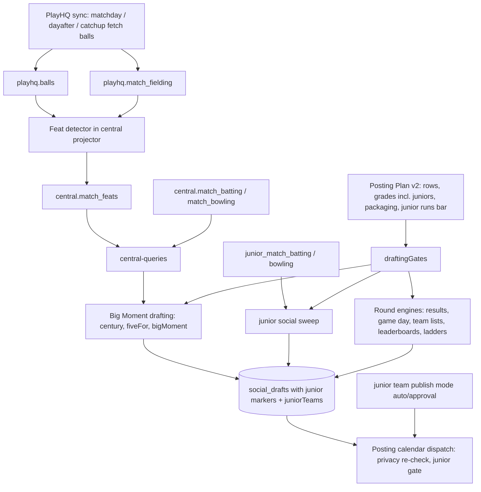

# Social Auto-Queue Criteria - Plan

## Goal Capsule

- **Objective:** A club decides, per card type, exactly what the app drafts into its queue, so a normal round produces a handful of cards an admin can review instead of dozens.
- **Product authority:** Ash (owner, Halls Head media officer). Product decisions made with him on 2026-10-15; this Product Contract is the authority, then the Planning Contract, then the units.
- **Execution profile:** Deep. Reshapes the shipped Posting Plan, adds two Big Moment triggers fed by ball-by-ball data and a new central table, extends juniors across rows, retires three card types and the brown junior look, and resets every club's settings.
- **Stop conditions:** Stop and ask Ash if a change would blend junior and senior stats, publish a junior card whose team is not set to `auto`, delete a posted card, or need a new secret or cron job.
- **Open blockers:** None.
- **Tail ownership:** Ash runs the production SQL in the order the runbook gives: `scripts/sql/central-projector.sql` before republishing, `scripts/sql/auto-queue-release.sql` after it, then the read-only checks and the feats backfill. Assistant sessions cannot reach production.

---

## Product Contract

Product Contract preservation: changed R5, R7, R12, R13, R15 and R21, Dependencies and Scope Boundaries, and resolved the Outstanding Questions. Planning found the Posting Plan already shipped (#353–#356), that posted cards of retired types must still display, that the live sync does not fetch ball-by-ball data, and that three table rows had no engine. Ash settled each change on 2026-10-15: fetch ball-by-ball data for played matches; move Record, Team of the week and Premiership to their own spec with real engines; junior auto-publishing is the existing per-team `auto` mode.

### Summary

The shipped Posting Plan table becomes the single place a club sets, per card type, whether it is auto-queued, for which senior and junior grades, and whether it posts as individual cards or one carousel per round.
Overlapping types merge into **Match result** and **Big Moment** (a century, five wickets, a hat-trick or five catches in an innings), and grade-leader, trading and countdown cards are retired.
The brown junior look is retired on cards and the website, and every club starts on a default table that makes roughly 5–8 cards a round.

### Problem Frame

After round 1 of 2026/27, Halls Head's queue held 48 open cards: 20 grade-leader cards (five per grade, every round), 15 achievement cards across every grade, about 11 match-day and team-list cards (per-fixture cards alongside round carousels, and repeated game-day rounds), a round-wrap carousel and one hand-made card.
With the posting calendar on (4 posts a day, 7-day age limit) most of them could never get a posting time and went straight to the Unscheduled tray.

The Posting Plan already lets a club switch rows and grades, but it still drafts grade leaders by default, has no hat-trick or catching moments, treats juniors as a separate system with its own on-by-default rules, and carries forward each club's old settings rather than a sensible default.
Achievement thresholds are fixed in code, several card types say the same thing, and junior cards are forced into a brown palette.

### Key Decisions

- **Retire and merge types before adding settings.** Fewer types is the biggest single cut in volume and in options.
- **Build on the shipped Posting Plan.** Its table is reshaped, not replaced; posting times stay with the posting calendar.
- **Big Moments keep a fixed bar.** Clubs choose grades, not thresholds; the one exception is a junior runs bar a club may lower to 50.
- **Fetch ball-by-ball data for played matches.** Hat-tricks need it, and the one extra request per match played stays within the pilot's non-commercial framing (Ash, 2026-10-15).
- **Packaging is a per-type club choice.** Every auto-queued type offers individual cards or one carousel per round where the type supports it.
- **Juniors are a first-class option, not a separate system.** A row can run for junior grades, with junior cards in the same carousel as seniors or in separate sets.
- **Junior auto-publishing is the per-team `auto` mode, off for every team at release.** A junior card or combined carousel publishes on its own only when every junior team on it is `auto`; anything the app cannot trace to a team waits.
- **New defaults for every club.** No carry-over: the flood stops at release, and a club that had switched match day off sees it on again until it changes the row.
- **One standard look.** Junior cards and the website's junior pages use the club's own look.
- **Only types with an engine appear in the table.** Record, Team of the week and Premiership return with their engines in the follow-on spec.

### Requirements

**Card types**

- R1. Weekend wrap, match summary and results summary merge into one **Match result** type.
- R2. Century, five-for and big moment merge into one **Big Moment** type.
- R3. Big Moment triggers on a century (100 runs), five wickets, a hat-trick, or five catches in one innings.
- R4. A hat-trick is three wickets credited to the same bowler on consecutive legal deliveries by that bowler in one innings, detected from ball-by-ball data; matches without ball-by-ball data produce no hat-tricks.
- R5. Grade-leader, trading-card and countdown types are retired: no engine drafts them and they cannot be made by hand; already-posted cards of these types still display.
- R6. Player, new signing, announcement and sponsor cards are never auto-queued; they remain available to make by hand.

**The per-type table**

- R7. The Posting Plan table lists every type an engine can draft, one row per type, and is the only place drafting is switched on or off.
- R8. Each row sets whether the type is auto-queued.
- R9. Each row sets which senior grades and which junior grades the type drafts for; junior grades only on rows with junior data (Match result, Team list, Game day, Big Moment).
- R10. Each row sets packaging: individual cards, or one carousel per round.
- R11. The Big Moment row lets a club lower the junior runs bar from 100 to 50; no other bar is adjustable.
- R12. The grade-leader row is removed from the table.

**Defaults**

- R13. Every club starts on this table:

| Type             | Auto-queue | Grades  | Packaging                                                                     |
| ---------------- | ---------- | ------- | ----------------------------------------------------------------------------- |
| Match result     | On         | Senior  | One carousel per round (individual cards for a club without association data) |
| Big Moment       | On         | Senior  | Individual                                                                    |
| Milestone        | On         | Senior  | Individual                                                                    |
| Debut            | On         | A Grade | Individual                                                                    |
| Team list        | On         | Senior  | One carousel per round                                                        |
| Game day         | On         | Senior  | One carousel per round                                                        |
| Ladder           | Off        | —       | One carousel per round                                                        |
| Club leaderboard | Off        | —       | One carousel per round                                                        |

**Juniors**

- R14. When a type runs for both senior and junior grades with carousel packaging, the club chooses one combined carousel or separate senior and junior carousels.
- R15. A club may set each junior team to auto-publish (the existing per-team `auto` mode); a junior card or combined carousel publishes on its own only when every junior team on it is `auto`. Every team is `approval` at release.
- R16. Junior privacy rules (the privacy override and opposition initials) apply to every junior card and every junior slide, however it is published, and are re-checked before a card publishes on its own.
- R17. A combined carousel only places junior and senior cards side by side; junior and senior stats are never combined.

**Look**

- R18. Junior cards use the club's standard card look.
- R19. The website's junior pages and junior banner use the club's colours instead of the brown junior look.

**Rollout**

- R20. At release, every club's settings reset to the default table (R13).
- R21. At release, unposted cards of retired types are dismissed after the new build is live; they stay visible under Dismissed and posted history is untouched.

### Acceptance Examples

- AE1. **Covers R3, R9.** Given Big Moment is on for A and B Grade only, when a C Grade batter scores 104, then no Big Moment is drafted.
- AE2. **Covers R11.** Given a club lowered the junior runs bar to 50, when an Under 14 batter scores 52, then a Big Moment is drafted; when a B Grade batter scores 52, then none is.
- AE3. **Covers R4.** Given a match scored ball by ball where one bowler takes wickets on three consecutive legal deliveries, then a hat-trick Big Moment is drafted; a wide between two of those wickets does not break it.
- AE4. **Covers R4.** Given a match without ball-by-ball data, then no hat-trick is drafted even if the scorecard shows a bowler with three wickets.
- AE5. **Covers R10, R13.** Given the default table, when a round of five senior matches finishes, then one Match result carousel is drafted, not five match cards.
- AE6. **Covers R14, R15.** Given Match result runs for senior and junior grades as one combined carousel and one junior team on it is `approval`, then that carousel waits for an admin; with every junior team on it `auto`, it publishes at its slot like a senior carousel.
- AE7. **Covers R21.** Given Halls Head's 20 open grade-leader cards at release, then all 20 move to Dismissed and none are deleted.
- AE8. **Covers R15, R16.** Given a junior Big Moment whose team cannot be identified, then it never publishes on its own; given a junior marked private after their card was drafted, then the card does not publish under their name.

### Success Criteria

- On round 1 2026/27 data, the default table drafts roughly 5–8 senior cards for Halls Head instead of 48.
- An admin can say, from the table alone, why any card in the queue was drafted.

### Scope Boundaries

**Next spec (agreed 2026-10-15)**

- Engines for Record, Team of the week and Premiership, with Team of the week driven by admin-set performance criteria, an optional points system weighted by grade, and senior and junior versions. Their rows join the table when those engines exist.

**Deferred for later**

- Adjustable thresholds for milestones, and any adjustable Big Moment bar besides the junior runs bar.
- A weekly or per-round cap on drafting; the calendar's daily cap already limits posting.
- Junior milestones, debuts, ladders and club leaderboards: there is no junior career or ladder data.
- Junior hat-tricks and five-catch innings: junior scorecards carry no ball-by-ball or fielder data.

**Outside this plan**

- Posting times, collisions, daily cap and age limit: these stay with the posting calendar's schedule.
- Who approves a card, beyond the per-team junior `auto` mode.

### Dependencies / Assumptions

- The Posting Plan (`docs/plans/2026-10-07-001-feat-social-posting-plan-plan.md`) is shipped on `main`; this plan reshapes its rows and keeps its posting styles, redefined to the new rows.
- Ball-by-ball data: the sync's match-day, day-after and catch-up runs will fetch `playhq.balls` for played matches (U10). Matches synced before that have no balls and produce no hat-tricks unless re-synced.
- Hat-tricks rely on `playhq.balls` (bowler, wicket and dismissal type per ball, ordered by `seq` within an innings) and five catches on `playhq.match_fielding` (`total_catches` per participant per innings).
- Junior Big Moments use `junior_match_batting` runs and `junior_match_bowling` wickets from the junior PlayHQ sync (#348).
- The app's central read role needs `select` on `central.match_feats`; the projector SQL grants it alongside the other central tables.

### Sources / Research

- Posting Plan model and styles: `lib/scorecard/src/posting-plan.ts`; API resolver and drafting gates: `artifacts/api-server/src/lib/posting-plan.ts`; editor: `artifacts/cricket-club/src/components/posting-plan/posting-plan-editor.tsx`, `plan-text.ts`, `grade-picker.tsx`.
- Achievement drafting: `lib/db/src/central/social-achievements.ts` (century 100, five-for 5, senior only), `artifacts/api-server/src/lib/central-achievements.ts`, `match-milestone-detector.ts`.
- Grade leaders and the season recap's champion cards: `artifacts/api-server/src/lib/roundup.ts`.
- Juniors: `artifacts/api-server/src/lib/junior-social.ts`, `junior-publishing.ts` (per-team `auto` / `approval` in `junior_sync_settings.team_publishing`), `junior-names.ts`; the junior exclusions in `lib/publishing/auto-publish.ts`, `lib/posting-slots.ts` and the SQL twin `juniorAutoPostClear` in `lib/effective-draft-state.ts`.
- Brown look: `JUNIOR_PANEL` in `artifacts/cricket-club/src/lib/pack-render/types.ts` and `tokens.ts`; `JUNIOR_BROWN` in `lib/share-card/theme.ts` and `lib/scorecard/src/match-summary-input.ts`; `--juniors-accent` from `brand.juniorsColour` in `lib/brand-context.tsx`.
- PlayHQ sync: `lib/db/src/playhq-ingest/cadence.ts` (`HarnessPlan.balls`, fixed to `"none"` today); landing tables `scripts/sql/playhq-schema.sql` (`playhq.balls`, `playhq.match_fielding`); projector `lib/db/src/playhq-ingest/central-project.ts`, `scripts/sql/central-projector.sql`; backfill script `scripts/src/playhq-project-central.ts`; CI builds `central.*` from `lib/db/src/central-schema` with `push-central`.

---

## Planning Contract

### Key Technical Decisions

- KTD1. **Posting Plan version 2 resets every club in code.** A stored plan that is not version 2, or no plan at all, resolves to the R13 default, which takes the club's central flag: Match result is a round carousel for a central club and individual cards otherwise. No production `UPDATE` of settings is needed, and the legacy-derivation branch (`legacyGates`, `derivePostingPlan`) is removed, so every drafting gate reads one plan. Saving still mirrors the legacy columns (`postingPlanWrite`). Rolling back to an older build restores each club's old legacy settings, grade leaders included; that is accepted, and the release SQL can be re-run after a roll-forward.
- KTD2. **Rows in version 2:** `results` (Match result), `bigMoments`, `milestones`, `debuts`, `gameDay`, `teamLists`, `clubLeaderboards`, `ladders`. `feats` and `gradeLeaders` are gone. Packaging is `individual` or `round`; `both` is removed.
- KTD3. **Big Moment is one row with existing designs underneath.** Centuries and five-fors keep the `century` and `fiveFor` card kinds and designs. Hat-tricks and five-catch innings draft as the existing `bigMoment` kind with a moment label. The queue and table call all four "Big Moment".
- KTD4. **Hat-tricks and five-catch innings are computed by the central projector.** When a PlayHQ match is projected into `central`, a pure detector reads its `playhq.balls` and `playhq.match_fielding` rows and writes events to a new `central.match_feats` table. The table and its grants live with the other central DDL (`scripts/sql/central-projector.sql` for production, `lib/db/src/central-schema` for CI's `push-central`), not in an app migration, because CI runs app migrations before the central schema exists. The app reads feats through `central-queries.ts` like every other central read.
- KTD5. **Hat-trick rule.** Take one bowler's deliveries in an innings in `seq` order, drop wides and no-balls, and look for three consecutive wickets whose dismissal type credits the bowler: bowled, caught, caught and bowled, lbw, stumped, hit wicket. A run out never counts. Overs and the batting order don't break it. Five catches means `total_catches` (fielder plus keeper) of 5 or more for one participant in one innings.
- KTD6. **Juniors per row.** A row's grade map covers junior age groups too. Junior grades are off unless the club lists them, which retires the junior sync's on-by-default rule (`juniorSynced`). Rows that can run for juniors: Match result, Team list, Game day and Big Moment (runs and five-fors only). Carousel rows with juniors on carry a `juniors: "combined" | "separate"` choice. Every junior card and every carousel with a junior slide sets `cardInput.junior = true` and records `juniorTeams: [{ ageGroup, teamName }]` for the teams its slides cover.
- KTD7. **Junior auto-publishing is the per-team `auto` mode, failing closed.** `juniorDraftMayAutoPublish(draft)` is true for senior cards; for any draft carrying a junior marker it is true only when `juniorTeams` is present and non-empty and every team resolves to `auto`. A missing team list, an unresolvable team, or any `approval` team means the card waits. The SQL twin (`juniorAutoPostClear`) changes to match. Because `auto` now means publishing to Facebook and Instagram, the release SQL resets every team to `approval`, and the runbook lists the teams that were `auto` so Ash can tell those clubs.
- KTD8. **Privacy is re-checked before auto-publishing.** The dispatch step re-resolves each junior player's private and override status for a junior card or combined carousel; if anything changed since drafting, the card is re-rendered when it can be and otherwise held for review.
- KTD9. **Retirement is at the entry points.** Retired kinds lose their engines, their create-a-card and card-set options, the Trading cards page and the countdown override. Their renderers, pack templates and caption templates stay so posted cards still display. The season recap's champion cards keep using the grade-leader renderer through the recap engine only.
- KTD10. **The brown look goes by removing the junior override.** Cards drop the forced `JUNIOR_PANEL` / `JUNIOR_BROWN` palette and use the club's tokens. Junior labels, photo rules and privacy stay. The website's `--juniors-accent` follows the club's primary colour. The `juniors_colour` columns stay in the database unread. The branding admin stops offering the setting.
- KTD11. **Release SQL is data-only and runs after the republish.** `scripts/sql/auto-queue-release.sql` dismisses open drafts of retired kinds, cancels their scheduled publications, and resets junior team publishing modes to `approval`. It is idempotent. It runs after the new build is live, because the old build's hourly sweep would re-draft grade leaders under the keys just dismissed. There is no app migration in this plan.
- KTD12. **The sync fetches ball-by-ball for played matches.** `HarnessPlan.balls` widens to `"none" | "since"`; the match-day, day-after and catch-up plans use `"since"` so each newly played match's balls land in `playhq.balls` before the projector runs. The weekly and pre-weekend plans stay `"none"`.

### High-Level Technical Design

### Assumptions

- Halls Head reads from central in production, so the central achievement path is the one exercised.
- Junior fixtures exist for the juniors' Game day row (the junior PlayHQ sync projects them). If a junior grade has no fixtures, the row drafts nothing for it.
- PlayHQ's `dismissal_type` values for bowler-credited dismissals are stable text. The detector's mapping is checked against captured fixtures.
- The ingest loads a match's balls before projecting it in the same run; if balls arrive in a later run, the match's feats appear on its next projection.

### Sequencing

U1 → U2 first: the model, then the gates. U10 (ball-by-ball fetch) and U3 (feats table and detector) can run alongside U2; U4 needs U2 and U3. U5 depends on U1 and U2. U6, U7 and U8 can follow in any order. U9 is last.

---

## Implementation Units

### U1. Posting Plan version 2 model

**Goal:** The shared plan model holds the version 2 rows, the junior grade and packaging options, the junior runs bar, the R13 defaults and the redefined styles.

**Requirements:** R1, R2, R7–R14, R20.

**Dependencies:** none.

**Files:**

- `lib/scorecard/src/posting-plan.ts` (modify)
- `lib/scorecard/src/posting-plan.test.ts` (modify)

**Approach:**

- `POSTING_ROWS` and `POSTING_ROW_DEFS` hold the KTD2 rows. The `bigMoments` row's kinds are century, fiveFor and bigMoment; the Match result row is labelled "Match result".
- `Packaging` narrows to `"individual" | "round"`.
- `PostingPlan` gains `version: 2`, a per-row `juniors?: "combined" | "separate"` and a plan-level `bigMoments.juniorRunsBar: 50 | 100`.
- `defaultPostingPlan(central)` is the R13 table: Match result `round` for a central club, `individual` otherwise; Debut limited to A Grade via the existing `A_GRADES`.
- `normalizePostingPlan` returns the default for any input that isn't version 2. `derivePostingPlan` and its legacy input are removed. `postingPlanToLegacy` stays and folds `bigMoments` into achievements.
- Styles: "Round carousels + individual highlights" becomes the R13 default. "Every match on its own" and "Results only" are redefined on the new rows.
- `invalidPostingPlan` rejects `both`, junior options on rows that can't run for juniors (KTD6), and round packaging on the Match result row for a non-central club.

**Patterns to follow:** the existing row-definition and normalize/validate shape in the same file.

**Test scenarios:**

- A version 1 plan, a null plan and a malformed plan all normalize to the R13 default.
- The central default has Match result as a round carousel, Big Moment individual and on for seniors, and Debut on for A Grade only.
- The non-central default has Match result as individual cards and passes `invalidPostingPlan`.
- `rowAllows` with no junior entries returns false for an Under 14 grade on every row.
- Listing "Under 14" on Match result makes it draft for that age group.
- `invalidPostingPlan` rejects juniors on Milestones, rejects `both` packaging, and accepts juniors on Big Moment.
- A junior runs bar of 75 is rejected; 50 and 100 are accepted.
- `postingPlanToLegacy` turns the achievements family on when only Big Moment is on.
- `matchingStyle` of the central default returns the "Round carousels + individual highlights" style.

**Verification:** the scorecard package tests pass and the old `feats` and `gradeLeaders` row ids no longer appear in the package.

### U2. Drafting gates read version 2 only

**Goal:** Every drafting decision reads the version 2 plan, grade leaders stop drafting, junior drafting follows the row grades, and every junior draft carries its markers.

**Requirements:** R5, R7, R9, R12, R14, R16, R17, R20.

**Dependencies:** U1.

**Files:**

- `artifacts/api-server/src/lib/posting-plan.ts` (modify)
- `artifacts/api-server/src/lib/draft-sweep.ts`, `post-commit-social.ts`, `routes/social-drafts.ts` (modify: drop round-up grade-leader drafting; keep `POST /social-recaps`)
- `artifacts/api-server/src/lib/junior-social.ts`, `engines/junior-team-list.ts`, `engines/round-sets.ts`, `match-summary-drafter.ts` (modify: junior gates read row grades; combined and separate carousels; junior markers)
- `artifacts/api-server/src/lib/posting-plan-readers.test.ts` (modify), `posting-plan-equivalence.test.ts` (delete), `posting-plan-ae1-sweep.test.ts` (modify), `junior-social.test.ts` (modify)

**Approach:**

- `draftingGates` and `loadDraftingGates` always build plan gates from `resolvePostingPlan(settings, central)`; `legacyGates` is removed.
- `gradeLeadersAny` and `gradeLeaders` are removed. `achievement` becomes `bigMoment(trigger, grade, junior)` plus `milestone` / `debut`.
- `juniorSynced(row, ageGroup)` is replaced by `rowAllows(row, ageGroup, true)`. A `juniorPackaging(row)` gate returns combined or separate.
- A round engine with juniors on builds either one carousel with senior slides then junior slides, or two carousels. Every carousel with a junior slide, and every individual junior card, sets `cardInput.junior = true` and `cardInput.juniorTeams` from its slides (KTD6). Junior slides use junior naming; senior and junior figures are never summed on a cover.
- `generateRoundUpDrafts` is no longer called by the sweep or post-commit paths. `generateRecapDrafts` keeps its champion cards.
- The equivalence test proved carry-over of legacy settings, which no longer exists. The readers test keeps its guard that no drafting module reads `familyConfig`, `roundSchedules.*.mode` or `engine*` directly.

**Patterns to follow:** the existing `planGates` and the reader guard in `posting-plan-readers.test.ts`; junior naming in `junior-social.ts`.

**Test scenarios:**

- A club with no saved plan and legacy settings that had matchday off now drafts game-day and team-list round carousels (R20).
- A scheduled sweep after a round drafts no `gradeLeader` cards.
- `POST /social-recaps` still drafts champion batsman and bowler cards.
- With Under 12 not listed on Team list, the junior team-list engine skips an Under 12 team that has a published side.
- With Under 12 listed, the junior team-list engine drafts that team's list, and the draft carries `junior: true` and `juniorTeams: [{ ageGroup: "Under 12", teamName }]`.
- With Match result on for seniors and juniors and `juniors: "separate"`, a round drafts one senior and one junior carousel.
- With `juniors: "combined"`, the same round drafts one carousel holding both, marked junior, listing every junior team on it, with each junior slide using junior naming and the cover showing senior and junior results in separate groups.
- The reader guard fails if a drafting module imports `resolveFamilyConfig`.

**Verification:** the API suites for the sweep, junior social, posting plan and post-commit paths pass.

### U3. Feat detection in the central projector

**Goal:** Hat-tricks and five-catch innings for PlayHQ-synced matches are stored in `central.match_feats`.

**Requirements:** R3, R4.

**Dependencies:** none (U10 supplies the data in production).

**Files:**

- `lib/db/src/playhq-ingest/feats.ts` (create: pure detector)
- `lib/db/src/playhq-ingest/feats.test.ts` (create)
- `lib/db/src/playhq-ingest/central-project.ts` (modify: write feats when projecting a match)
- `lib/db/src/central-schema/match_feats.ts` (create), `lib/db/src/central-schema/index.ts` (modify)
- `scripts/sql/central-projector.sql` (modify: the table, the projector's write grant and the app read role's select grant)
- `lib/db/src/central-queries.ts` or the central read module that serves achievements (modify: read feats for a club's recent matches)

**Approach:**

- Each feat row holds match id, innings number, participant id, club id and kind (`hatTrick` | `fiveCatches`), plus detail: the three dismissals, or the catch count.
- The detector takes one match's ordered balls and fielding rows and returns feats. It is pure, so it can be tested without a database.
- The projector deletes and re-inserts a match's feats each time it projects that match, so re-syncs stay idempotent. `scripts/src/playhq-project-central.ts` therefore backfills feats for matches projected before release.
- Private players are excluded at read time, as for other achievements.

**Patterns to follow:** existing projections and their tests in `lib/db/src/playhq-ingest/` (`central-transform.ts`, `project.test.ts`); the existing central DDL layout in `central-projector.sql`.

**Test scenarios:**

- Covers AE3. Three consecutive bowler-credited wickets by one bowler give one hat-trick; a wide between the second and third doesn't break it.
- A hat-trick whose middle wicket is caught and bowled is detected.
- Wickets on two consecutive deliveries then a dot ball give no hat-trick.
- A run out as the middle wicket gives no hat-trick.
- A hat-trick spanning the end of one over and the start of that bowler's next over is detected.
- Four consecutive wickets give one hat-trick feat, not two.
- A keeper with 3 catches and 2 stumpings is not five catches; a keeper with 5 total catches is.
- Covers AE4. A match with no balls gives no hat-trick feats.
- Re-projecting a match leaves exactly the same feat rows.

**Verification:** the detector unit tests and the projector DB tests pass; CI's `push-central` creates `central.match_feats` from the schema; the projected rows match the fixture.

### U4. Big Moment drafting

**Goal:** The Big Moment row drafts centuries, five-fors, hat-tricks and five-catch innings for its grades, and junior Big Moments use the junior runs bar and carry junior markers.

**Requirements:** R2, R3, R9, R11, R16.

**Dependencies:** U2, U3.

**Files:**

- `artifacts/api-server/src/lib/central-achievements.ts` (modify: century and five-for gated by `bigMoment`; draft `bigMoment` cards from feats)
- `artifacts/api-server/src/lib/match-milestone-detector.ts`, `post-commit-social.ts` (modify: native path uses the same gate)
- `artifacts/api-server/src/lib/junior-social.ts` (modify: junior Big Moments from junior batting and bowling)
- `artifacts/api-server/src/lib/central-achievements.test.ts`, `junior-social.test.ts` (modify)

**Approach:**

- Feats draft as `bigMoment` with `momentLabel` "Hat-trick" or "Five catches", the player and opposition. Each gets its own draft key per match, innings and player.
- Junior Big Moments use runs ≥ the plan's `juniorRunsBar` or wickets ≥ 5, with names from `makeJuniorNaming` and the opposition as initials. They set `cardInput.junior = true` and `juniorTeams` with the player's team, so the junior photo and publishing rules apply.
- A private or withheld junior is skipped.

**Patterns to follow:** `buildAchievementDrafts` and `draftKeys.matchFeat` for keys; junior naming in `junior-social.ts`.

**Test scenarios:**

- Covers AE1. With Big Moment on for A and B Grade, a C Grade 104 drafts nothing and an A Grade 104 drafts a century card.
- A hat-trick feat in A Grade drafts one `bigMoment` card labelled "Hat-trick".
- Re-running the sweep doesn't duplicate it.
- A five-catches feat for a private player drafts nothing.
- Covers AE2. With the junior runs bar at 50 and Under 14 listed, a junior 52 drafts a Big Moment; a B Grade 52 does not.
- With the bar at 100, the junior 52 drafts nothing.
- A junior Big Moment carries `junior: true` and one junior team, its opposition reads as initials, its player's name follows the club's junior naming style, and the rendered card hides the player photo.
- With Big Moment off, no century, five-for or feat cards draft.

**Verification:** the achievement and junior social suites pass.

### U5. Junior auto-publish through the per-team mode

**Goal:** Junior cards and combined carousels publish at their slot only when every junior team on them is `auto`, with privacy re-checked first; anything untraceable waits.

**Requirements:** R15, R16, R17.

**Dependencies:** U1, U2.

**Files:**

- `artifacts/api-server/src/lib/junior-publishing.ts` (modify: `juniorDraftMayAutoPublish`, fail-closed; privacy re-check helper)
- `artifacts/api-server/src/lib/effective-draft-state.ts` (modify: `juniorAutoPostClear` matches the new rule)
- `artifacts/api-server/src/lib/posting-slots.ts` (modify: junior dispatch gate and privacy re-check)
- `artifacts/api-server/src/lib/publishing/auto-publish.ts` (modify: candidates)
- `artifacts/api-server/src/lib/junior-publishing.test.ts`, `posting-slots.test.ts`, `effective-draft-state.test.ts` (modify)

**Approach:**

- Replace the blanket `isJunior` exclusion with `juniorDraftMayAutoPublish(draft)` as KTD7 defines it: senior cards pass; a draft with either junior marker passes only when `cardInput.juniorTeams` is non-empty and every entry resolves to `auto`. Missing or unresolvable means wait.
- Before dispatching a junior card or combined carousel, re-resolve each junior player's private and override status (KTD8). If unchanged, dispatch; if a player became private or lost an override, re-render the card with current naming when the engine can, otherwise clear its ready state and notify the club.
- Loader-era junior summaries and junior round sets have no `juniorTeams`, so they always wait.

**Patterns to follow:** `juniorTeamPublishMode` in `junior-publishing.ts`; the dispatch transaction in `posting-slots.ts`.

**Test scenarios:**

- Covers AE6. A combined carousel with one junior team on `approval` is nudged, not published.
- With that team on `auto`, the same carousel is scheduled for publishing at its slot.
- A junior Big Moment for an `auto` team publishes.
- The same card for an `approval` team waits.
- Covers AE8. A junior card with no `juniorTeams`, a loader-era junior summary and a junior round set are never published, whatever the team modes.
- Covers AE8. A junior marked private after drafting is not published under their name: the card is re-rendered with the withheld name, or held with a notification.
- `juniorAutoPostClear` and `juniorDraftMayAutoPublish` agree on every fixture draft.
- A senior card's behaviour is unchanged.

**Verification:** the posting-slots, auto-publish, effective-draft-state and junior-publishing suites pass.

### U6. Retire grade-leader, trading-card and countdown types

**Goal:** No new cards of the retired types can be made, while posted ones still display.

**Requirements:** R5, R6.

**Dependencies:** U2.

**Files:**

- `artifacts/cricket-club/src/components/card-kind-picker.tsx`, `lib/social-studio.ts`, `components/card-forms/descriptors.ts` (modify: remove the options)
- `artifacts/cricket-club/src/pages/admin-trading-cards.tsx` (delete), `pages/admin-groups.tsx`, `lib/admin-nav.ts`, `App.tsx`, `pages/admin-social-studio.tsx` (modify: remove the tab, nav, redirects and link)
- `artifacts/cricket-club/src/components/social-sets/sources/grade-leader-source.tsx` (delete), `components/social-sets/sources/index.tsx`, `components/social-sets/model.ts` (modify)
- `lib/api-spec/openapi.yaml` (modify: drop `gradeLeader` from the card-set generate kind and remove the countdown season-start override), then regenerate the client
- `artifacts/api-server/src/routes/social-cards-sets.ts`, `lib/card-set-generate-store.ts` and the countdown override route (modify)
- `artifacts/cricket-club/src/__tests__/` tests for the kind picker and create-a-card (modify)

**Approach:**

- The `CardKind` enum keeps all kinds so posted drafts still validate and render.
- `routes/trading-card-settings.ts` and its table stay unread for now (their removal is deferred).
- `posting-schedule.ts` slot mappings for retired kinds stay, so posted history still classifies.

**Patterns to follow:** earlier kind retirements (`newCap`, noted in `lib/share-card/types.ts`).

**Test scenarios:**

- The create-a-card picker lists no grade-leader (Leaderboard), Trading Card or Countdown option; Club leaderboard is unaffected.
- `/admin/social/trading-cards` redirects to the Studio home.
- A posted `gradeLeader` draft still renders in the queue drawer.
- The card-set generate route rejects `gradeLeader` with 400.

**Verification:** the web and API suites pass, and codegen leaves no drift.

### U7. Posting Plan editor for version 2

**Goal:** The Posting Plan tab edits version 2: the new rows, junior grades per row, the combined-or-separate choice, the junior runs bar, and a note on junior auto-publishing.

**Requirements:** R7–R11, R13–R15.

**Dependencies:** U1.

**Files:**

- `artifacts/cricket-club/src/components/posting-plan/posting-plan-editor.tsx`, `plan-text.ts`, `grade-picker.tsx` (modify)
- `artifacts/cricket-club/src/__tests__/posting-plan.test.tsx` (modify)
- `lib/api-spec/openapi.yaml` (modify: `PostingPlan` schema version 2 fields), then regenerate the client
- `artifacts/api-server/src/routes/social-cards.ts` (modify: the save path accepts version 2 and passes the club's central flag to the default)

**Approach:**

- The first-visit "Keep my current settings" choice goes, because there is nothing to keep (KTD1). The style picker starts on the default.
- The grade picker lists junior age groups beneath the senior grades on rows that allow juniors.
- A combined/separate select appears once a carousel row has any junior grade on.
- The Big Moment row gets a "Juniors: 50 or 100 runs" select.
- A line under the table says junior cards publish to Facebook and Instagram on their own only for teams set to "auto" in the junior team settings, that every team starts on "approval", with a link there.

**Patterns to follow:** the existing desktop table and phone card layouts in the editor.

**Test scenarios:**

- A first visit shows the default table with no "Keep my current settings" option.
- Turning on Under 14 for Match result reveals the combined/separate select.
- Turning it off again hides the select.
- The Big Moment junior bar select offers 50 and 100 only, and saving sends the chosen value.
- Milestones shows no junior grades.
- The packaging select offers no "both" option.
- The save request carries `version: 2`.

**Verification:** the web suite passes, and the cricket-club typecheck is clean.

### U8. Retire the brown junior look

**Goal:** Junior cards and the website's junior pages use the club's own colours.

**Requirements:** R18, R19.

**Dependencies:** none.

**Files:**

- `artifacts/cricket-club/src/lib/pack-render/types.ts`, `tokens.ts`, `club-kit-vars.ts`, `render.ts` (modify: remove the forced junior panel)
- `artifacts/cricket-club/src/lib/share-card/theme.ts`, `export.ts`, `compose.ts`, `share-card-animation.ts` (modify)
- `lib/scorecard/src/match-summary-input.ts`, `lib/scorecard/src/brand.ts` (modify)
- `artifacts/cricket-club/src/components/share-card-modal/use-theme-style.ts` (modify)
- `artifacts/cricket-club/src/lib/brand-context.tsx` (modify: `--juniors-accent` follows the primary colour)
- `artifacts/cricket-club/src/pages/admin-branding.tsx`, `components/platform-admin/branding-card.tsx` (modify: remove the juniors colour field)
- The existing pack-render and share-card theme tests (modify)

**Approach:**

- The `junior` flag on card inputs keeps driving junior labels and photo rules, but no longer the palette.
- The mobile app's plaque theme is deferred.

**Patterns to follow:** the club-kit token resolution in `tokens.ts`.

**Test scenarios:**

- A junior match summary resolves the same panel colour as a senior one for the same club.
- A junior card still shows junior labels and hides photos where it did before.
- On the website, `--juniors-accent` equals the club's primary colour.
- The branding admin shows no juniors colour field.

**Verification:** the web suite passes, and a junior card rendered in the browser preview uses club colours.

### U9. Release SQL, runbook and docs

**Goal:** Ship safely: production SQL in the right order, a runbook entry, and current docs.

**Requirements:** R20, R21.

**Dependencies:** U1–U8, U10.

**Files:**

- `scripts/sql/auto-queue-release.sql` (create)
- `docs/runbooks/meta-publishing.md` (modify: the deploy order)
- `AGENTS.md`, `CLAUDE.md` (modify: drop the "keep the juniors-banner brown" note; record the version 2 plan, Big Moment and the ball-by-ball fetch), `CONCEPTS.md` (update the Posting Plan entry; Big Moment and Match result are already added)

**Approach:**

- `auto-queue-release.sql`, idempotent:
  - `update social_drafts set status = 'dismissed', reviewed_at = now()` for drafts with status `awaiting_review` or `ready` whose `card_input->>'kind'` is in (`gradeLeader`, `tradingCard`, `countdown`), and cancel those drafts' scheduled publications.
  - Reset every entry in `junior_sync_settings.team_publishing` to `approval`.
- Runbook deploy order:
  1. Before republishing: re-run `scripts/sql/central-projector.sql` in the Production SQL runner; check `to_regclass('central.match_feats')`.
  2. Read-only: list clubs and junior teams currently `auto` in `team_publishing`, so Ash can tell those clubs their setting now means publishing.
  3. Republish.
  4. Run `auto-queue-release.sql`; read-only checks: open retired-kind drafts = 0, junior teams on `auto` = 0.
  5. Backfill feats for 2026/27 with `scripts/src/playhq-project-central.ts`; read-only count of feats by kind.
  6. Confirm the next match-day sync run fetched balls (row count in `playhq.balls` for a played match).

**Patterns to follow:** the idempotent style of `0041_social_posting_calendar.sql` and the runbook §3a checks.

**Test scenarios:**

- Covers AE7. Running the release SQL on a test database with 20 open `gradeLeader` drafts and one posted one dismisses the 20, leaves the posted one, and a second run changes nothing.
- A junior team on `auto` is `approval` after the SQL; a second run leaves it `approval`.

**Verification:** `drizzle-kit generate` reports no drift (this plan adds no app migration). The release SQL applies twice locally without error.

### U10. Ball-by-ball fetch on played-match syncs

**Goal:** The sync fetches each played match's ball-by-ball data so the projector can detect hat-tricks.

**Requirements:** R3, R4.

**Dependencies:** none.

**Files:**

- `lib/db/src/playhq-ingest/cadence.ts` (modify: `HarnessPlan.balls` widens to `"none" | "since"`; match-day, day-after and catch-up plans use `"since"`)
- `lib/db/src/playhq-ingest/cadence.test.ts` (modify)
- `.claude/skills/playcricket-stats-scraper/harness.js` and its references (modify if the harness ignores the `balls` plan field today)
- `lib/db/src/playhq-ingest/load.ts`, `load.test.ts` (verify balls load before projection; modify only if ordering needs it)
- `docs/runbooks/meta-publishing.md` or the PlayHQ sync notes in `AGENTS.md` (modify: the scrape-volume change and Ash's approval of 2026-10-15)

**Approach:**

- Only plans that run after matches are played fetch balls; the weekly and pre-weekend plans don't.
- The harness fetches balls per match in the plan's window and posts them with the rest of the dump; the loader already lands `playhq.balls`.

**Execution note:** confirm with a captured dump that balls for one match arrive and project in the same ingest run before relying on it in U3's DB test.

**Patterns to follow:** the existing per-plan fields in `cadence.ts` and their tests.

**Test scenarios:**

- The match-day, day-after and catch-up plans carry `balls: "since"`; weekly and pre-weekend carry `"none"`.
- A loaded dump with balls for one match results in `playhq.balls` rows ordered by `seq` for that match.

**Verification:** the cadence and load tests pass; the runner's sync-harness tests still pass.

---

## Verification Contract

| Gate                        | Command / check                                                                                             | Applies to    |
| --------------------------- | ----------------------------------------------------------------------------------------------------------- | ------------- |
| Scorecard tests             | `lib/scorecard` vitest suite                                                                                | U1, U8        |
| API tests                   | `artifacts/api-server` vitest, full suite, on the local embedded Postgres                                   | U2, U4–U6, U9 |
| DB / projector / sync tests | `lib/db` vitest (`playhq-ingest`, central projection)                                                       | U3, U10       |
| Web tests                   | `artifacts/cricket-club` vitest, full suite                                                                 | U6–U8         |
| Typecheck                   | `tsc --build` on the libs, then `tsc --noEmit` for api-server and cricket-club                              | all           |
| Codegen drift               | orval regenerate leaves no diff                                                                             | U6, U7        |
| Migration drift             | `drizzle-kit generate` reports no changes; `push-central` applies `lib/db/src/central-schema` cleanly in CI | U3, U9        |
| Format and lint             | Prettier 3.9.6 check, `eslint` on changed files                                                             | all           |
| CI                          | GitHub CI green on the PR                                                                                   | all           |

## Definition of Done

- Every unit's test scenarios are implemented and pass. Existing posting-plan, sweep, junior, publishing, sync and render tests pass, changed only where this plan changes behaviour.
- AE1–AE8 each have a passing test.
- No drafting module reads legacy settings columns; the reader guard enforces it.
- No junior card publishes unless every junior team on it is `auto`; untraceable junior cards never auto-publish; junior and senior stats are never combined.
- The release SQL is idempotent, and the runbook's ordered steps and checks are written down for Ash.
- CI is green: lint, typecheck, codegen drift, migration drift, API, DB and web tests.
- No abandoned-attempt code, unused helpers or debug logging remain in the diff.

### Deferred to Follow-Up Work

- Engines for Record, Team of the week and Premiership (next spec), then their rows in the table.
- Delete the retired kinds' renderers, pack templates, caption templates and `trading_card_settings` once no posted card of those kinds remains worth showing.
- Mobile app junior plaque theme.
